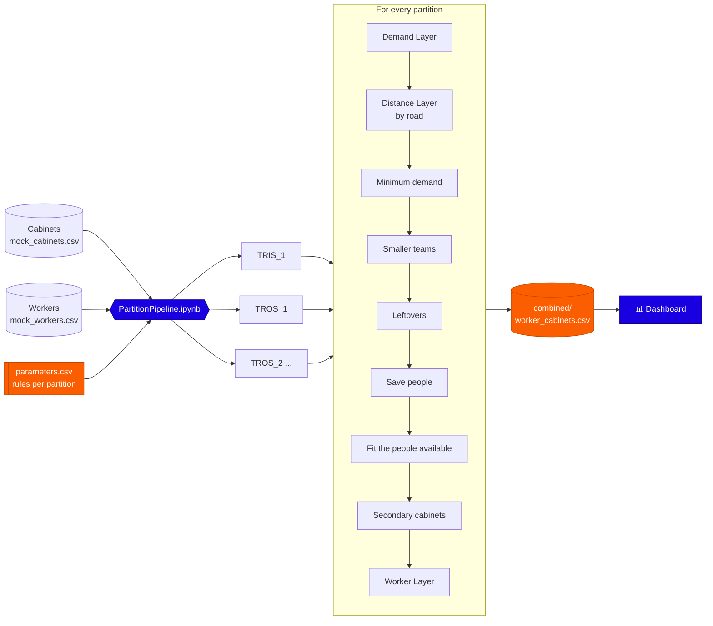

<a id="top"></a>

<div align="center">


# Two-layer Cabinet Clustering

**Turns telecom cabinets into daily field-work clusters: right-sized teams, reachable by road, staffed by the nearest workers.**

<p>
  
  
  
  
  
  
</p>

[🎬 Demo](#demo) · [✨ What it does](#features) · [🧭 How it works](#how-it-works) · [🚀 Quick start](#quick-start) · [📊 Dashboard](#dashboard) · [🗂️ Structure](#structure)

</div>

---

<a id="demo"></a>

## 🎬 Demo

<div align="center">

<!-- Replace VIDEO_ID (two places) with the ID of the YouTube video: https://youtu.be/VIDEO_ID -->
<a href="https://youtu.be/VIDEO_ID">
  
</a>

<sub>▶ Click to watch the walkthrough: from the cabinet file to the dashboard.</sub>

</div>

---

<a id="features"></a>

## ✨ What it does

Every cluster is **one day of field work for one team**, a card on the manager's calendar. The model decides how many
clusters there are, which cabinets go in each, how many people each one needs, and who those people are.

<table>
<tr>
<td width="50%" valign="top">

### 📦 Demand Layer
Splits the cabinets with demand-weighted k-means, repairs any cluster over its team's maximum and evens out the load,
so every day is a worthwhile one.

</td>
<td width="50%" valign="top">

### 🛣️ Distance Layer
Keeps every cabinet within `RADIUS_KM` **by road** of its cluster centre, using our own OSRM server on OpenStreetMap
roads. A straight line is only a flagged last resort.

</td>
</tr>
<tr>
<td valign="top">

### 👥 Right-sized teams
Quiet areas get smaller teams, down to one person. *Save people* passes cabinets on wherever that lets a cluster drop
a person.

</td>
<td valign="top">

### ⚖️ Fit to the people available
The demand is scaled so the clusters use the people who are actually there, and the model reruns until the teams fit.

</td>
</tr>
<tr>
<td valign="top">

### 🧩 Partitions
TRIS (internal ground team) and every TROS contractor are planned on their own, each with its **own rules** from
`parameters.csv`, then combined into one result.

</td>
<td valign="top">

### 🧑‍🔧 Worker Layer
Fills each cluster with the nearest workers of its partition, using the Hungarian method on road distances. Every
worker gets a list of Primary and Secondary cabinets.

</td>
</tr>
</table>

---

<a id="how-it-works"></a>

## 🧭 How it works



**Three rules every cluster keeps**

| | Rule | In short |
|---|---|---|
| 1️⃣ | **Demand** | A team of *n* takes between *n* × `MIN_DEMAND_PER_PERSON` and *n* × `DEMAND_PER_PERSON` tickets/day. |
| 2️⃣ | **Distance** | Every cabinet is within `RADIUS_KM` by road of its centre. |
| 3️⃣ | **No overlap** | The outline around a cluster's cabinets never overlaps another cluster's outline. |

Every cabinet ends up in exactly one cluster. Cabinets that need a fallback are flagged, so nothing breaks a rule
without it showing.

---

<a id="quick-start"></a>

## 🚀 Quick start

**1. Install the packages** (once)

```bash
pip install -r requirements.txt
```

**2. Start the road server.** Double-click `start_osrm.bat` and keep its window open; the one-time set-up steps are
at the top of that file.

**3. Check the rules.** Open `parameters.csv`: one row per partition. A new contractor only needs a new row.

**4. Run the pipeline.** Open `PartitionPipeline.ipynb`, set `CABINET_FILE` and `WORKER_FILE` in the first cell and
run all cells. The results go to `outputs/partitions/`.

**5. Explore.** Double-click `run_dashboard.bat`, or:

```bash
python -m streamlit run dashboard/app.py
```

> [!TIP]
> To plan a single partition by hand, run `ClusteringModel.ipynb` with `PARTITION` set, then `WorkerLayer.ipynb`
> with the same `PARTITION`.

---

<a id="dashboard"></a>

## 📊 Dashboard

| Tab | What you get |
|---|---|
| **Overview** | Clusters, people needed and available, fill rate, demand scale and the team of every cluster |
| **Analytics** | Workload, fill rate, tickets per person, team mix, distance curves, demand against reach, backup work, workers' trips |
| **Partitions** | All partitions **combined** (with a filter) or **side by side**, with their rules compared and differences marked |
| **Maps** | The interactive cluster map: outlines, territories, centres and flagged cabinets |
| **Step by step** | Every step of the model on a map, from the first split to the final clusters |
| **Secondary view** | One cluster's own cabinets and the backup work around it |
| **Clusters** | Searchable tables and downloads |
| **Workers** | Who works where, every base and trip, and empty places |
| **New run** | Upload a cabinet file, set the rules and run the model |

---

## ⚙️ Model rules

<details>
<summary><b>parameters.csv</b>: one row per partition (click to open)</summary>

<br>

| Column | Meaning | Blank means |
|---|---|---|
| `PEOPLE_PER_CLUSTER` | biggest team | required |
| `MIN_PEOPLE` | smallest team | required |
| `DEMAND_PER_PERSON` | most tickets/day for one person | required |
| `MIN_DEMAND_PER_PERSON` | fewest tickets/day that make a worthwhile day | required |
| `SOLO_MAX_DEMAND` | special case: one person may take up to this | no special case |
| `RADIUS_KM` | every cabinet within this road distance of its centre | required |
| `MAX_SECONDARY` | backup cabinets kept per cluster | keep all |
| `TOTAL_PEOPLE` | people available per day | count the partition's workers |
| `MAX_DEMAND_SCALE` · `FIT_ROUNDS` · `SEED` · `BALANCE_TOL` | fitting and tuning | 3 · 5 · 67 · 1.0 |

```csv
partition,PEOPLE_PER_CLUSTER,MIN_PEOPLE,DEMAND_PER_PERSON,MIN_DEMAND_PER_PERSON,SOLO_MAX_DEMAND,RADIUS_KM,...
TRIS_1,6,1,6,4,7,15,...
TROS_2,6,1,7,4,,15,...
```

</details>

---

## 📦 Outputs

The main result is **`outputs/partitions/combined/worker_cabinets.csv`**: one row per worker and cabinet.

| staff_id | CabinetId | type | partition | cluster_id |
|---|---|---|---|---|
| `N01_001` | `CAB0123` | **Primary**: a cabinet of the worker's own cluster | `TRIS_1` | `TRIS_1-C001` |
| `N01_001` | `CAB0456` | **Secondary**: backup work nearby | `TRIS_1` | `TRIS_1-C001` |

Next to it: `clusters.csv`, `teams.csv`, `assignments.csv`, `secondaries.csv`, `worker_assignments.csv`,
`cluster_workers.csv` and a `summary.csv` per partition and in total. Every partition also gets its own interactive
maps.

---

<a id="structure"></a>

## 🗂️ Project structure

<details>
<summary>Click to open</summary>

```text
.
├── PartitionPipeline.ipynb    # start here: every partition, combined
├── ClusteringModel.ipynb      # the model, for one partition
├── WorkerLayer.ipynb          # the nearest workers for every cluster
├── parameters.csv             # the rules, one row per partition
├── dashboard/                 # Streamlit dashboard (app, loaders, runner, theme)
├── Dataset/                   # mock cabinets and workers (real data stays local)
├── tools/                     # notebooks that make the mock data
├── previous_versions/         # earlier versions of the model, for reference
├── docs/                      # slides and low-level design
├── start_osrm.bat             # starts the local road server
├── run_dashboard.bat          # opens the dashboard
└── requirements.txt
```

</details>

---

## 🔒 Data

Only made-up data is in this repo: `Dataset/mock_cabinets.csv` and `Dataset/mock_workers.csv`. Real files go in
`Dataset/real/`, and results in `outputs/`; neither is pushed. Road distances come from a local OSRM server, so no
coordinates leave the machine.

---

<div align="center">


<sub>Built during an internship at <b>Telekom Malaysia</b> · NEO-I</sub>

<sub><a href="#top">↑ Back to top</a></sub>

</div>
