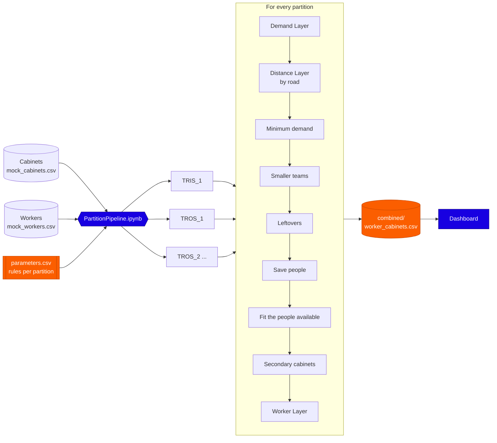

# "Two"-layer Cabinet Clustering


A planning model that groups telecom cabinets into daily field-work clusters and assigns field workers to them.
Each cluster is one day of work for one team. The model sizes every team to its cluster's expected ticket load,
keeps every cabinet within a set road distance of the cluster centre, and staffs each cluster with the nearest
available workers.

## Contents

- [Demo](#demo)
- [Overview](#overview)
- [Method](#method)
- [Getting started](#getting-started)
- [Configuration](#configuration)
- [Outputs](#outputs)
- [Dashboard](#dashboard)
- [Repository layout](#repository-layout)
- [Data](#data)

## Demo

<!-- Replace VIDEO_ID (two places) with the ID of the YouTube video: https://youtu.be/VIDEO_ID -->
[](https://youtu.be/4EUoficTd20)

A walkthrough from the input files to the dashboard.

## Overview

The input is a list of cabinets with their location and expected tickets per day, and a list of workers with their
base location. Cabinets and workers belong to a partition: `TRIS_1` is the internal ground team, and `TROS_1`,
`TROS_2` and so on are external contractors. Every partition is planned separately, with its own rules, and the results
are combined at the end.

Every cluster satisfies three rules:

| Rule | Description |
|---|---|
| Demand | A team of *n* people takes between *n* × `MIN_DEMAND_PER_PERSON` and *n* × `DEMAND_PER_PERSON` tickets per day. |
| Distance | Every cabinet is within `RADIUS_KM` of the cluster centre by road. |
| No overlap | The convex hull of a cluster's cabinets does not overlap that of any other cluster. |

Every cabinet is assigned to exactly one cluster. Cabinets that can only be placed with a fallback rule are flagged in
the output.

## Method

The model runs in two layers, followed by a set of refinement steps.

1. **Demand layer.** The number of clusters is set from the total demand. Demand-weighted k-means makes the first
   split; a repair step moves cabinets out of overloaded clusters, and a balancing step evens out the load.
2. **Distance layer.** Road distances from each centre to its cabinets come from a local OSRM server. Cabinets beyond
   `RADIUS_KM` are moved to a neighbouring cluster, separated, or their cluster is split.
3. **Minimum demand.** Clusters below a full team's minimum are merged, shared out or topped up from neighbours.
4. **Smaller teams.** Clusters in quiet areas are given smaller teams, one person fewer per round.
5. **Leftovers.** Clusters that fit no team size are dissolved into the nearest cluster.
6. **Staffing fit.** Demand is scaled so the clusters use the workers available, and the model is rerun until the team
   sizes fit.
7. **Secondary cabinets.** Each cluster lists nearby cabinets of other clusters as backup work.
8. **Worker layer.** Workers are matched to clusters with the Hungarian method, minimising the total road distance
   from their bases.



## Getting started

### Requirements

- Python 3.11 or later
- A local OSRM server with a Malaysia extract from Geofabrik (set-up steps in `start_osrm.bat`)

### Installation

```bash
pip install -r requirements.txt
```

### Usage

1. Start the road server with `start_osrm.bat` and keep its window open.
2. Review `parameters.csv`. It holds one row per partition.
3. Open `PartitionPipeline.ipynb`, set `CABINET_FILE` and `WORKER_FILE` in the first cell, and run all cells.
4. Open the dashboard:

```bash
python -m streamlit run dashboard/app.py
```

To plan a single partition, run `ClusteringModel.ipynb` with `PARTITION` set, then `WorkerLayer.ipynb` with the same
value.

## Configuration

Model rules are read from `parameters.csv`, one row per partition. Adding a partition only needs a new row.

| Column | Description | Default when blank |
|---|---|---|
| `PEOPLE_PER_CLUSTER` | Largest team size | required |
| `MIN_PEOPLE` | Smallest team size | required |
| `DEMAND_PER_PERSON` | Maximum tickets per person per day | required |
| `MIN_DEMAND_PER_PERSON` | Minimum tickets per person per day | required |
| `SOLO_MAX_DEMAND` | Upper limit for a one-person cluster, used only when needed | equal to `DEMAND_PER_PERSON` |
| `RADIUS_KM` | Maximum road distance from cabinet to cluster centre | required |
| `MAX_SECONDARY` | Number of secondary cabinets kept per cluster | all |
| `TOTAL_PEOPLE` | Workers available per day | count of the partition's workers |
| `MAX_DEMAND_SCALE` | Maximum factor by which demand may be scaled up | 3 |
| `FIT_ROUNDS` | Maximum reruns to fit the available workers | 5 |
| `SEED` | Random seed for k-means | 67 |
| `BALANCE_TOL` | Load difference at which balancing stops, in tickets per day | 1.0 |

## Outputs

Results are written to `outputs/partitions/`, with one folder per partition and a `combined/` folder for all
partitions together. The main file is `combined/worker_cabinets.csv`, with one row per worker and cabinet:

| Column | Description |
|---|---|
| `staff_id` | Worker ID |
| `CabinetId` | Cabinet ID |
| `type` | `Primary` for a cabinet in the worker's own cluster, `Secondary` for nearby backup work |
| `partition` | Partition of the worker and the cluster |
| `cluster_id` | Cluster ID, prefixed with the partition (for example `TRIS_1-C001`) |

The combined folder also contains `clusters.csv`, `assignments.csv`, `teams.csv`, `secondaries.csv`,
`worker_assignments.csv`, `cluster_workers.csv` and `summary.csv`. Each partition folder includes interactive maps.

## Dashboard

The Streamlit dashboard reads the results and can run the model on a new file.

| Tab | Content |
|---|---|
| Overview | Clusters, people required and available, fill rate, team per cluster |
| Analytics | Workload, fill rate, tickets per person, team sizes, distances, backup work, worker trips |
| Partitions | All partitions combined with a filter, or two partitions side by side with their rules compared |
| Maps | Interactive cluster map |
| Step by step | The clusters after each step of the model |
| Secondary view | A cluster's own cabinets and the backup work around it |
| Clusters | Searchable cluster and cabinet tables, with downloads |
| Workers | Worker assignments, bases, trip distances and unfilled places |
| New run | Upload a cabinet file, set the rules and run the model |

## Repository layout

```text
.
├── PartitionPipeline.ipynb    Runs every partition and combines the results
├── ClusteringModel.ipynb      Clustering model for one partition
├── WorkerLayer.ipynb          Assigns workers to the clusters of one partition
├── parameters.csv             Model rules, one row per partition
├── dashboard/                 Streamlit dashboard
├── Dataset/                   Sample cabinet and worker files
├── tools/                     Notebooks that generate the sample data
├── previous_versions/         Earlier versions of the model
├── docs/                      Slides and low-level design
├── start_osrm.bat             Starts the local OSRM server
├── run_dashboard.bat          Starts the dashboard
└── requirements.txt
```

## Data

The repository contains generated sample data only (`Dataset/mock_cabinets.csv` and `Dataset/mock_workers.csv`).
Real input files belong in `Dataset/real/`, and results in `outputs/`; both are excluded by `.gitignore`. Road
distances are computed on a local OSRM server, so no location data is sent to external services.

---
