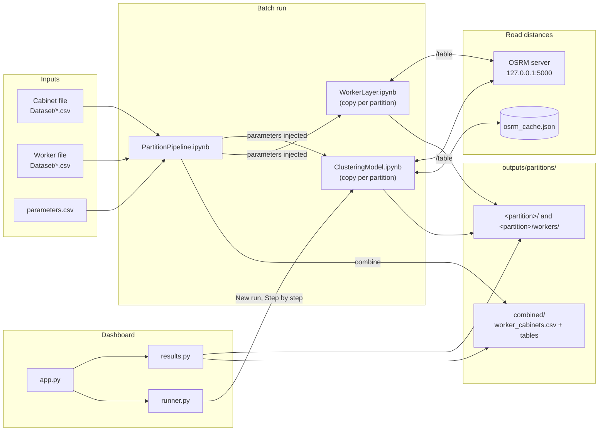
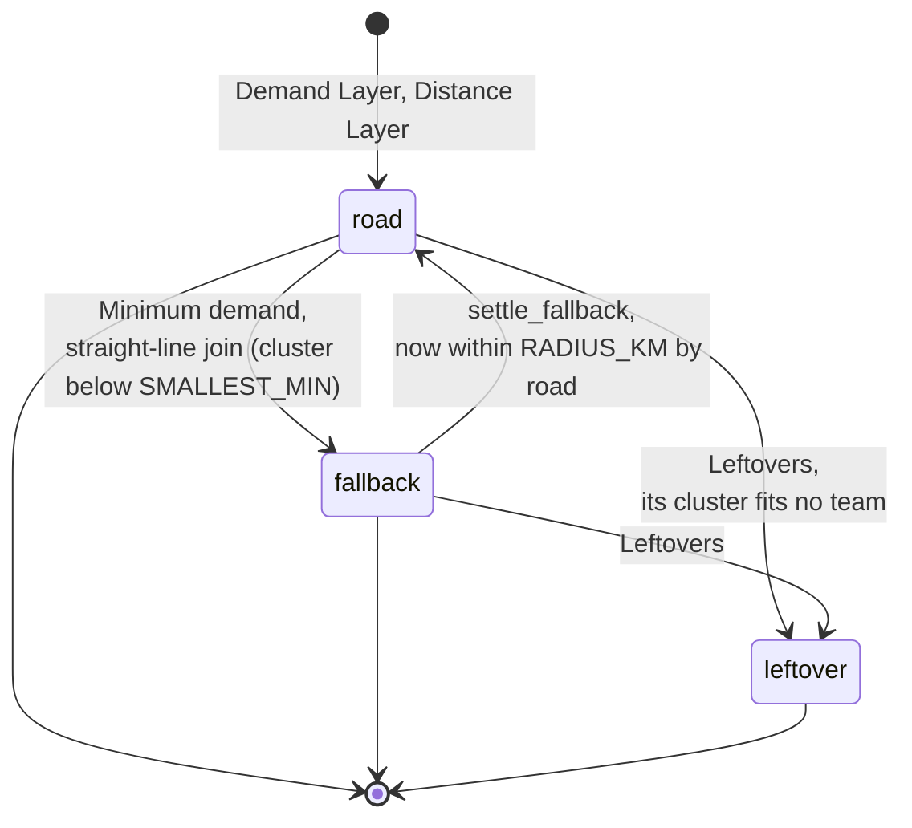
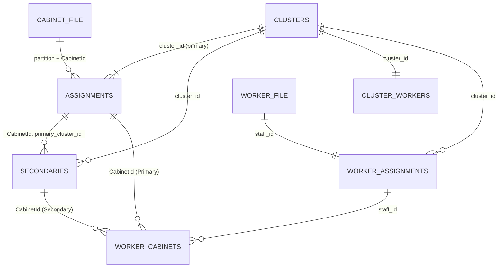
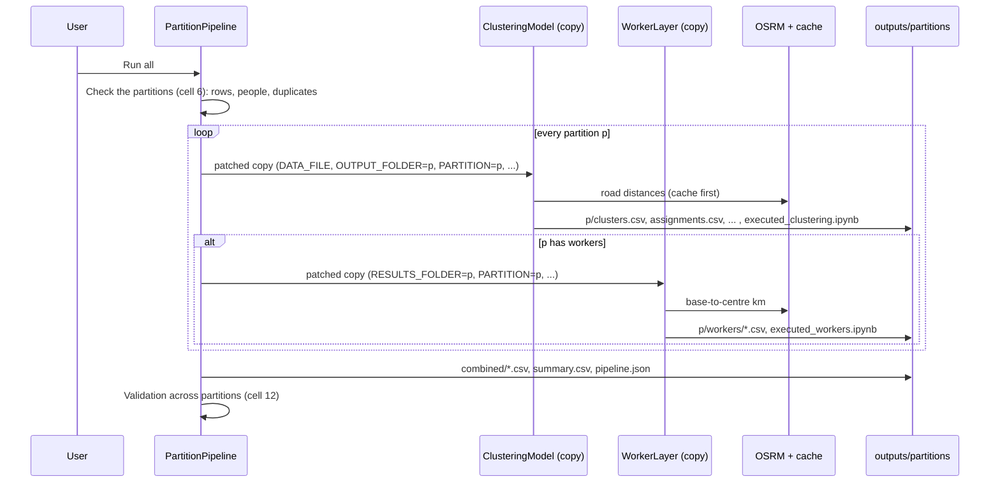
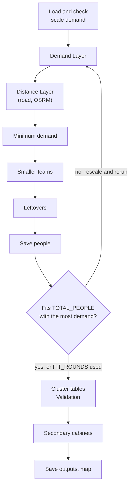
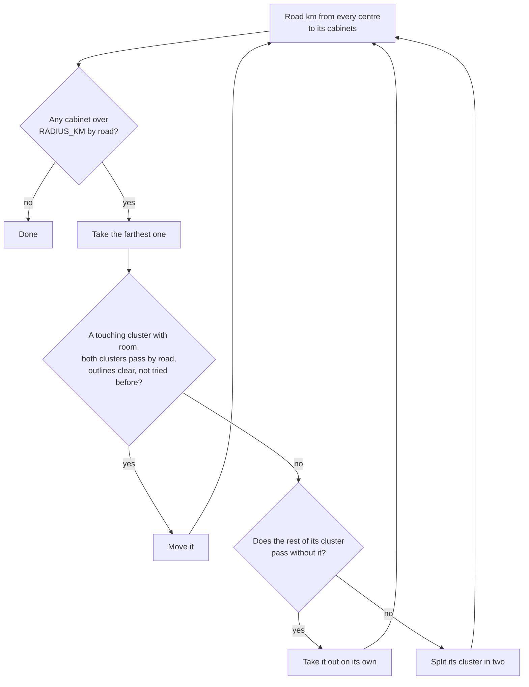
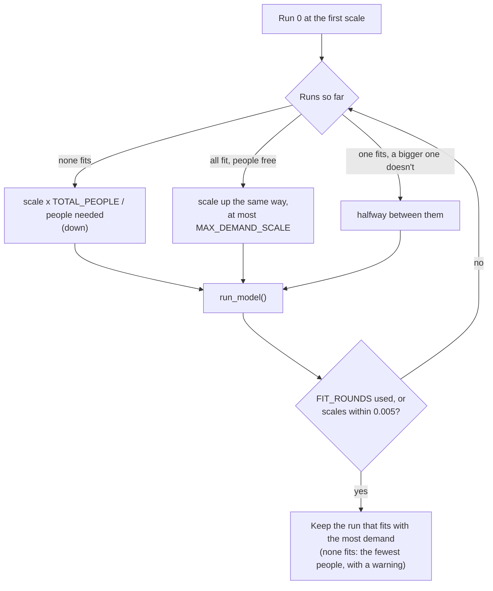

# LLD – Two-layer Clustering Model

Low-level design of the cabinet clustering model, the worker matching, the partition pipeline and the parts of the
dashboard that run them. It describes the code as it is today (an *as-built* LLD).

## Contents

0. [How to read this document](#0-how-to-read-this-document)
1. [Document info](#1-document-info)
2. [LLD Manifest](#2-lld-manifest)
3. [Scope and assumptions](#3-scope-and-assumptions)
4. [Module structure](#4-module-structure)
5. [Interfaces and function signatures](#5-interfaces-and-function-signatures)
6. [Data structures](#6-data-structures)
   - [6A. Storage and file formats](#6a-storage-and-file-formats)
7. [Key flows and pseudocode](#7-key-flows-and-pseudocode)
8. [Errors and exceptional paths](#8-errors-and-exceptional-paths)
9. [Concurrency, transactions and idempotency](#9-concurrency-transactions-and-idempotency)
10. [Configuration](#10-configuration)
11. [Test design](#11-test-design)
12. [Traceability](#12-traceability)
13. [Open questions and findings](#13-open-questions-and-findings)
14. [Change log](#14-change-log)

---

## 0. How to read this document

This section says who the document is for and defines the words used everywhere else.

**Who it is for.** Engineers and analysts who run, maintain or extend the model. You should know Python and pandas;
no knowledge of the notebooks is assumed.

**Reading paths**

| You want to | Read |
|---|---|
| Understand what the model does | §3, §4, then §7.2 with the worked example in §7.3 |
| Run it or change a rule | §5.1, §5.2, §10 |
| Change a step of the model | §5.3 for the functions, §7.2 for the logic, §11 for the checks to keep passing |
| Use or load the outputs | §6A |
| Find out why a run stopped | §8 |

**Glossary**

| Term | Meaning |
|---|---|
| Cabinet | A street cabinet that needs field visits. One row of the cabinet file (`CabinetId`). |
| Demand | Tickets per day at a cabinet (`demand`, an average). The model may scale it, see *demand scale*. |
| Cluster | A group of cabinets worked by one team for one day. IDs `C001`, `C002`, ...; in combined files `TRIS_1-C001`. |
| Team / people | The number of people a cluster needs (`people`). |
| Team band | The demand a team of *n* can take: *n* × `MIN_DEMAND_PER_PERSON` to *n* × `DEMAND_PER_PERSON`. |
| `CAP` | The band's top for the biggest team: `PEOPLE_PER_CLUSTER` × `DEMAND_PER_PERSON` (36 with the default rules). |
| `MIN_DEMAND` | The band's bottom for the biggest team: `PEOPLE_PER_CLUSTER` × `MIN_DEMAND_PER_PERSON` (24). |
| `SMALLEST_MIN` | The band's bottom for the smallest team: `MIN_PEOPLE` × `MIN_DEMAND_PER_PERSON` (4). |
| Centre | The plain average of a cluster's cabinet positions, leaving out flagged cabinets. |
| `RADIUS_KM` | Every cabinet must be within this distance **by road** of its cluster centre (15 km). |
| Outline | The convex hull of a cluster's cabinets. Outlines of two clusters must not overlap. |
| Touching | A cabinet touches a cluster when one of its Voronoi neighbours is in it. Moves are only tried into touching clusters. |
| Straight-line fallback | A cabinet that cannot be within `RADIUS_KM` by road of any centre, so it is allowed in a straight line and flagged. |
| Leftover | A cabinet of a cluster no team fits, moved to the nearest cluster with no distance limit and flagged. |
| Flagged cabinet | A fallback or leftover cabinet. It counts for its cluster's demand but does not move the centre. |
| Partition | Whose work a cabinet is: `TRIS_1` is the internal ground team; `TROS_1`, `TROS_2`, ... are external teams. Each is planned on its own. |
| Demand scale | `DEMAND_SCALE`: one factor applied to every cabinet's demand so the clusters use the people available. |
| Places | A team of 5 becomes 5 places; the Worker Layer fills places with workers. |
| Base | Where a worker's day starts (`latitude`, `longitude` in the worker file); workers of one node share it. |
| OSRM | The road-routing server (Open Source Routing Machine) that gives road km. Runs locally on this laptop. |

---

## 1. Document info

| Item | Value |
|---|---|
| Document | LLD – Two-layer Clustering Model |
| Version | v1.0 |
| Author | Iman Thaqif |
| Date | 2026-10-29 |
| Code baseline | `main` at commit `ede6c06` (2026-10-24) |
| PRD baseline | None. Requirements are recovered from `README.md` and the notebooks' intro cells (§12). |
| HLD baseline | None. The README's method section and pipeline graph serve as the high-level design. |
| Contract baseline | None (no network API). The notebook parameter interface is specified in §5.1. |
| Guardrails | None. |
| Status | Draft for review |

---

## 2. LLD Manifest

The modules this LLD includes, and why the others don't apply.

| Module | Included | Reason if not | Where |
|---|---|---|---|
| Core | Y | – | §3 to §12 |
| Storage & file formats | Y | – | §6A |
| API Contract | N/A | No network API. The interface between notebooks is their first code cell, covered in Core. | §5.1 |
| Async / Event | N/A | No queues or events. Runs are sequential batch jobs. | §9 |
| Infra / IaC | N/A | Runs on one laptop. No cloud resources. | §3.4 |
| External Integration | Covered in Core | OSRM is part of the main flow, so it is documented with the steps that use it. | §3.4, §7.2.2, §8.2 |
| Frontend UX | N/A | Not chosen. The dashboard is covered at module level only. | §4.3, §7.6 |
| Observability | N/A | Not chosen. The printed log lines and validation checks that exist are listed. | §8.4, §11.1 |
| Security / Compliance | N/A | Not chosen. Findings from the survey are listed as open questions. | §13 |
| Deployment / Release | N/A | Not chosen. Set-up steps are in the README and `start_osrm.bat`. | §3.4 |
| SDK / Library | N/A | Not a library. | – |

---

## 3. Scope and assumptions

What this LLD covers, what it leaves out, and what the design depends on.

### 3.1 In scope

- `ClusteringModel.ipynb`: the main model (called *v4* in the dashboard). Plans one partition.
- `WorkerLayer.ipynb`: picks the workers for one partition's clusters.
- `PartitionPipeline.ipynb`: runs both notebooks for every partition and combines the results.
- `parameters.csv`: the model rules per partition.
- `dashboard/runner.py` and `dashboard/results.py`: how the dashboard runs the model and reads results.
- `tools/generate_mock_cabinets.ipynb` and `tools/generate_mock_workers.ipynb`: the mock data.
- Every input and output file (§6A).

### 3.2 Out of scope

- `previous_versions/two_layer_clustering_v2_road.ipynb` (v2, the older road model, still selectable in the
  dashboard as "Older model") and `previous_versions/two_layer_clustering_v3_crowflybla.ipynb` (v3, straight-line
  only, retired). They are mentioned only where the dashboard treats them differently.
- The dashboard's screens in detail (`dashboard/app.py`). §4.3 lists the tabs; §7.6 covers the runs it starts.
- Route planning within a cluster's day. The model measures from the centre, not along a route.

### 3.3 Key assumptions

| # | Assumption | Basis | If it does not hold |
|---|---|---|---|
| A1 | A local OSRM server answers on `http://127.0.0.1:5000` with the Malaysia, Singapore and Brunei extract. | `start_osrm.bat`; `OSRM_URL` in the notebooks | The Distance Layer stops (§8.2), unless `ALLOW_FALLBACK = True`. |
| A2 | Road km are free-flow (no traffic) and measured from where a point meets the nearest road. | Model notes, CM cell 43 | Real trips can be longer; the radius is a planning figure. |
| A3 | One plan covers one day. `demand` is an average per day. | README; WL cell 23 | Busy days exceed `CAP`; the fill rate is indicative. |
| A4 | Partitions are independent: cabinets, rules, people and workers never cross partitions. | PP cell 0 | The combined validation (§11.1) fails. |
| A5 | Coordinates are in one region (a city or a state). | CM cell 9: the km projection is local | k-means and outlines get distorted over a whole country. |
| A6 | Only mock data is committed; real data stays in `Dataset/real/`. | `.gitignore`, README | – |

### 3.4 Dependencies

| Dependency | Type | Used by | Notes |
|---|---|---|---|
| Python 3.11+ (tested on 3.13 Anaconda) | Runtime | all | `requirements.txt` lists minimum versions. |
| pandas, numpy | Library | all | Tables and arrays. |
| scikit-learn | Library | CM, mock generators | `KMeans` (demand-weighted, and k = 2 for splits). |
| shapely | Library | CM, `results.py` | Convex hulls, Voronoi areas, overlap checks (`STRtree`). |
| scipy | Library | WL, `results.py` | `linear_sum_assignment` (Hungarian method); Delaunay for step colours. |
| requests | Library | CM, WL | OSRM `/table` calls. |
| folium | Library | CM, WL, mock generators | `map.html`. |
| nbformat, nbclient, ipykernel | Library | PP, `runner.py` | Execute in-memory copies of notebooks. |
| streamlit, plotly | Library | dashboard | UI and charts. |
| OSRM (`osrm-bindings`, `osrm routed`) | Local service | CM, WL | Started by `start_osrm.bat` from `D:\osrm`; MLD algorithm, `--max-table-size 1000`, listens on 127.0.0.1 only. |
| Geofabrik `malaysia-singapore-brunei-latest.osm.pbf` | Map data | OSRM | Prepared once with `extract`, `partition`, `customize` (about 7 minutes). Tracks drivable at 10 km/h. |

---

## 4. Module structure

How the repository is laid out, which part calls which, and what each one is responsible for.

### 4.1 Repository layout

```
.
├── ClusteringModel.ipynb        # the model: one partition's cabinets -> clusters and team sizes
├── WorkerLayer.ipynb            # one partition's clusters + workers -> who works where
├── PartitionPipeline.ipynb      # runs both notebooks for every partition, combines the results
├── parameters.csv               # model rules, one row per partition
├── requirements.txt             # Python libraries
├── start_osrm.bat               # starts the local road server
├── run_dashboard.bat            # starts the dashboard
├── .streamlit/config.toml       # dashboard theme and upload limit
├── dashboard/
│   ├── app.py                   # Streamlit app: tabs, charts, maps, New run form
│   ├── runner.py                # runs notebook copies for the dashboard; records the step-by-step view
│   ├── results.py               # finds and reads result sets; metrics; upload checks
│   ├── step_map/index.html      # small custom component that keeps one Plotly map alive
│   ├── style.css, assets/       # look and feel
├── tools/
│   ├── generate_mock_cabinets.ipynb
│   └── generate_mock_workers.ipynb
├── Dataset/
│   ├── mock_cabinets.csv        # 404 made-up cabinets in 3 partitions (committed)
│   ├── mock_workers.csv         # 55 made-up workers (committed)
│   └── real/                    # real data (gitignored)
├── outputs/                     # every run's results (gitignored)
├── previous_versions/           # v2 and v3 notebooks, for reference
└── docs/lld/LLD.md              # this document
```

### 4.2 How the parts connect



### 4.3 Responsibilities

| Module | Responsibility | Depends on |
|---|---|---|
| `ClusteringModel.ipynb` (CM) | Reads one partition's cabinets and rules; builds clusters that keep the demand band, the road radius and clear outlines; sizes each team; fits the people available; lists secondary cabinets; validates; writes the tables and the map. | `parameters.csv`, OSRM, cache |
| `WorkerLayer.ipynb` (WL) | Reads one partition's clusters and workers; matches workers to places with minimum total road km; writes who works where and on which cabinets. | CM outputs, OSRM |
| `PartitionPipeline.ipynb` (PP) | Checks every partition can run; runs CM then WL per partition on in-memory copies; combines all tables; validates across partitions. | CM, WL, nbclient |
| `dashboard/results.py` | Finds result sets (the main notebook's results, partition runs, dashboard runs); reads them into data frames; computes metrics and per-step views; checks uploaded files. | output files |
| `dashboard/runner.py` | Creates dashboard runs, injects parameters into notebook copies, executes them, records each step's labels into `steps.csv`, merges the run's road cache into the shared one. | CM, v2, nbclient |
| `dashboard/app.py` | Streamlit UI. Tabs: Overview, Analytics, Partitions (Combined, Side by side), Maps, Step by step, Secondary view, Clusters, Workers, New run. | `results.py`, `runner.py` |
| `tools/generate_mock_cabinets.ipynb` | Makes realistic made-up cabinets around real town centres, with tickets and partitions. | `results.validate_upload` |
| `tools/generate_mock_workers.ipynb` | Makes made-up workers at node bases, shared out by demand. | the cabinet file |

### 4.4 Inside ClusteringModel.ipynb

The notebook has 44 cells (0 to 43) in 15 sections. Each section is a markdown cell followed by its code.

| Cells | Section | What it does |
|---|---|---|
| 0 | Title | The two rules, the step table, the data columns. |
| 1–4 | Setup and parameters | Files and OSRM settings (cell 2, the parameter cell); installs missing libraries; imports and paths. |
| 5–6 | Model rules | Reads the partition's row of `parameters.csv`; derived values. |
| 7–8 | Load and check the data | Reads cabinets; drops zero demand; scales demand to the people available. |
| 9–10 | Distance helpers | Haversine, local km projection, centres. |
| 11–12 | Outlines and neighbours | Convex hulls, overlap checks, Voronoi neighbours. |
| 13–15 | Demand Layer | k-means, repair, split, balance. |
| 16–19 | Distance Layer | OSRM and cache; the road-rule loop. |
| 20–22 | Minimum demand | Merge, share out, top up, straight-line fallback. |
| 23–24 | Smaller teams | One person fewer each round. |
| 25–26 | Leftovers | Break up clusters no team fits; settle fallbacks. |
| 27–28 | Save people | Pass cabinets on to drop a person. |
| 29–30 | Fit the people available | Rescale and rerun; keep the best run. |
| 31–32 | Cluster tables | `clusters` and `assignments` frames. |
| 33–34 | Validation | Hard checks. |
| 35–36 | Secondary cabinets | Backup cabinets per cluster. |
| 37–38 | Result summary | Printed summary. |
| 39–40 | Save outputs | CSV files. |
| 41–42 | Interactive map | `map.html`. |
| 43 | Notes and limitations | |

WorkerLayer has 24 cells in 12 sections; PartitionPipeline has 15 cells in 7 sections. Their sections are listed in
§5.3.9 and §5.3.10.

---

## 5. Interfaces and function signatures

How the notebooks are called, the rules they read, and every function, grouped by step.

### 5.1 The notebook parameter interface

Each notebook's **first code cell** is its interface. Callers never edit the file. They load it into memory, replace
values in that cell, and execute the copy.

**Replacement rule** (PP cell 8 `patched()`, `runner.patched_copy()`, `runner._set_values()`):

```python
re.subn(rf"^{name}\s*=.*$", f"{name} = {value!r}", cell.source, flags=re.M)
# exactly one match is required, otherwise RuntimeError("parameter <name> not found")
```

- The whole line, inline comment included, is replaced by `NAME = repr(value)`.
- So a parameter must stay on one line, start at column 0 and appear once in the cell.
- Values must be Python literals: strings, numbers, `None`, `True`/`False`.

**ClusteringModel.ipynb, cell 2**

| Name | Default | Meaning |
|---|---|---|
| `DATA_FILE` | `"Dataset/mock_cabinets.csv"` | Cabinet file, relative to the working folder. |
| `OUTPUT_FOLDER` | `"outputs"` | Where results go. |
| `PARAMETER_FILE` | `"parameters.csv"` | The rules file. |
| `PARTITION` | `"TRIS_1"` | Partition to plan. `None` = the whole file (no partition column, or only one partition). |
| `WORKER_FILE` | `"Dataset/mock_workers.csv"` | Only used to count people when `TOTAL_PEOPLE` is blank. `None` = no limit. |
| `CACHE_FILE` | `None` | Road cache. `None` = `OUTPUT_FOLDER/cache/osrm_cache.json`. |
| `OSRM_URL` | `"http://127.0.0.1:5000"` | Road server. |
| `OSRM_PROFILE` | `"driving"` | OSRM profile, also part of the cache key. |
| `OSRM_BATCH` | `100` | Most coordinates (sources + destinations) per request. |
| `OSRM_PAUSE_S` | `0` | Pause before each request (1.0 for the public demo server). |
| `ALLOW_FALLBACK` | `False` | If OSRM cannot be reached, use straight-line × 1.4 instead of stopping. |

**WorkerLayer.ipynb, cell 2**

| Name | Default | Meaning |
|---|---|---|
| `RESULTS_FOLDER` | `"outputs"` | The clustering results to staff. |
| `WORKER_FILE` | `"Dataset/mock_workers.csv"` | Worker list. |
| `PARTITION` | `"TRIS_1"` | Only this partition's workers. Must match `rules.csv` of the results. |
| `OUTPUT_FOLDER` | `"outputs/workers"` | Where results go. |
| `DISTANCE` | `"road"` | `"road"` (OSRM) or `"straight"` (haversine) for the matching cost. |
| `OSRM_URL`, `OSRM_PROFILE`, `OSRM_BATCH`, `ALLOW_FALLBACK` | as in CM | |
| `OSRM_RETRIES` | `4` | Attempts per request. |
| `FALLBACK_FACTOR` | `1.4` | Straight-line multiplier when falling back. |

**PartitionPipeline.ipynb, cell 2**

| Name | Default | Meaning |
|---|---|---|
| `CABINET_FILE` | `"Dataset/mock_cabinets.csv"` | Cabinets of every partition. |
| `WORKER_FILE` | `"Dataset/mock_workers.csv"` | Workers of every partition. |
| `PARAMETER_FILE` | `"parameters.csv"` | Rules. |
| `OUTPUT_FOLDER` | `"outputs/partitions"` | Results root. |
| `PARTITIONS` | `None` | List of partitions to run. `None` = all in the cabinet file. |
| `CACHE_FILE` | `"outputs/cache/osrm_cache.json"` | Road cache shared by every partition. |
| `TIMEOUT_S` | `4 * 3600` | Timeout **per cell** for each executed notebook. |

**What each caller sets**

| Caller | Notebook | Values injected |
|---|---|---|
| PP, per partition `p` | CM | `DATA_FILE=CABINET_FILE`, `OUTPUT_FOLDER=<OUTPUT_FOLDER>/<p>`, `PARAMETER_FILE`, `PARTITION=p`, `WORKER_FILE`, `CACHE_FILE` |
| PP, per partition `p` with workers | WL | `RESULTS_FOLDER=<OUTPUT_FOLDER>/<p>`, `WORKER_FILE`, `PARTITION=p`, `OUTPUT_FOLDER=<OUTPUT_FOLDER>/<p>/workers` |
| `runner.patched_copy` (New run, v4) | CM | `DATA_FILE="dataset.csv"`, `OUTPUT_FOLDER="outputs/v4"`, `PARAMETER_FILE="parameters.csv"` (a one-row `ALL` file written into the run folder from the form), `PARTITION=None`, `WORKER_FILE=None` |
| `runner.build_steps` (pipeline partition) | CM | `DATA_FILE`, `OUTPUT_FOLDER`, `PARAMETER_FILE=<partition>/rules.csv`, `PARTITION`, `WORKER_FILE=None`, `CACHE_FILE` |

The OSRM settings are never injected, so the notebook defaults apply in every pipeline run (see §13).

### 5.2 Rules from parameters.csv

One row per partition; the `partition` column is the key. Row `ALL` is for a cabinet file without a partition column.
Other columns (such as `notes`) are ignored. Read by `read_parameters(path, partition)` in CM cell 6.

| Rule | Type | Required | Blank means | Range check | Meaning |
|---|---|---|---|---|---|
| `PEOPLE_PER_CLUSTER` | int | yes | – | ≥ 1 | Biggest team. |
| `MIN_PEOPLE` | int | yes | – | 1 ≤ x ≤ `PEOPLE_PER_CLUSTER` | Smallest team. |
| `DEMAND_PER_PERSON` | number | yes | – | > 0 | Most tickets/day for one person. |
| `MIN_DEMAND_PER_PERSON` | number | yes | – | 0 < x ≤ `DEMAND_PER_PERSON` | Fewest tickets/day that make a worthwhile day. |
| `SOLO_MAX_DEMAND` | number | no | `DEMAND_PER_PERSON` (no special case) | ≥ `DEMAND_PER_PERSON` | One person may take up to this as a special case. |
| `RADIUS_KM` | number | yes | – | > 0 | Road radius around each centre. |
| `MAX_SECONDARY` | int | no | keep all | ≥ 1 | Backup cabinets kept per cluster, nearest first. |
| `TOTAL_PEOPLE` | int | no | the partition's workers in `WORKER_FILE`; no limit if `WORKER_FILE` is `None` | ≥ 1 | People available per day. |
| `MAX_DEMAND_SCALE` | number | no | 3 | ≥ 1 | Most the demand may be scaled up. |
| `FIT_ROUNDS` | int | no | 5 | ≥ 0 | Most extra runs to fit `TOTAL_PEOPLE`. |
| `SEED` | int | no | 67 | – | k-means random seed. |
| `BALANCE_TOL` | number | no | 1.0 | – | Balancing stops when heaviest − lightest ≤ this (tickets/day). |

**Current rows**

| partition | PPC | MIN_P | DPP | MIN_DPP | SOLO | RADIUS | MAX_SEC | TOTAL | SCALE | FIT | SEED | TOL |
|---|---|---|---|---|---|---|---|---|---|---|---|---|
| ALL | 6 | 1 | 6 | 4 | 7 | 15 | 10 | blank | 3 | 5 | 67 | 1.0 |
| TRIS_1 | 6 | 1 | 6 | 4 | 7 | 15 | 10 | blank | 3 | 5 | 67 | 1.0 |
| TROS_1 | 6 | 1 | 6 | 4 | 7 | 15 | 10 | blank | 3 | 5 | 67 | 1.0 |
| TROS_2 | 6 | 1 | 7 | 4 | blank | 15 | 10 | blank | 3 | 5 | 67 | 1.0 |

**Derived values** (CM cells 6 and 8)

| Name | Formula | Default rules |
|---|---|---|
| `CAP` | `PEOPLE_PER_CLUSTER × DEMAND_PER_PERSON` | 36 |
| `MIN_DEMAND` | `PEOPLE_PER_CLUSTER × MIN_DEMAND_PER_PERSON` | 24 |
| `SMALLEST_MIN` | `MIN_PEOPLE × MIN_DEMAND_PER_PERSON` | 4 |
| `PEOPLE_CAPACITY` | `TOTAL_PEOPLE × DEMAND_PER_PERSON` | – |
| `DEMAND_SCALE` | `min(MAX_DEMAND_SCALE, PEOPLE_CAPACITY / raw total demand)`; 1 with no limit | – |
| `K_MIN` | `ceil(total demand / CAP)` | – |
| `K_MAX` | `max(K_MIN, floor(total demand / SMALLEST_MIN))` | – |

### 5.3 Functions

Every function, grouped by the step it belongs to. "Returns" gives the shape of the result; all functions work on the
module-level arrays of §6.1 unless they take labels as an argument.

#### 5.3.1 Rules and data (CM cells 6, 8)

| Function | Inputs | Returns | Purpose |
|---|---|---|---|
| `column(df, name)` | frame, column name | matching column name or `None` | Case-insensitive column lookup. |
| `partition_of(path, partition)` | cabinet file, `PARTITION` | partition name | The partition this run plans: the one given, the file's only partition, or `"ALL"` without a partition column. |
| `count_workers(path, partition)` | worker file, partition | int | Workers of the partition, for a blank `TOTAL_PEOPLE`. |
| `read_parameters(path, partition)` | rules file, partition | `{rule: value}` | Reads and checks the partition's row (§5.2). |
| `read_cabinets(path, partition)` | cabinet file, partition | frame `CabinetId, cabinetlat, cabinetlong, demand` | Reads the partition's cabinets with standard column names. |

#### 5.3.2 Distance helpers (CM cell 10)

| Function | Inputs | Returns | Purpose |
|---|---|---|---|
| `haversine_km(lat1, lon1, lat2, lon2)` | arrays or scalars | km | Great-circle distance; broadcasts like numpy. |
| `project_km(lat, lon)` | arrays | `n × 2` km | Equirectangular projection around the data's mean latitude. |
| `unproject_km(xy)` | `n × 2` km | `n × 2` (lon, lat) | Inverse, used for map shapes. |
| `members_of(labels, p)` | labels, cluster | positions | Cabinets in cluster `p`. |
| `centre_of(members, flagged=None)` | positions, flags | (lat, lon) | Mean position, leaving out flagged cabinets unless all are flagged. |
| `cluster_stats(labels, flagged=None)` | labels, flags | (parts, inv, load, clat, clon) | Per-cluster demand and centre in one pass. |
| `dist_to_centre(labels, flagged=None)` | labels, flags | km per cabinet | Straight-line km to own centre. |
| `fits_radius(members, radius_km, skip=None)` | positions, km, flags | bool | All within the radius of their centre in a straight line. |

#### 5.3.3 Outlines and neighbours (CM cell 12)

| Function | Inputs | Returns | Purpose |
|---|---|---|---|
| `outline(members)` | positions | shapely polygon (km) | Convex hull, memoised in `_OUTLINES` (cleared above 200,000 entries). |
| `overlap(a, b)` | two shapes | bool | They intersect and do not merely touch. |
| `outlines_clear(changes, labels, skip=None)` | `{cluster: positions}`, labels, flags | bool | A proposed change keeps every outline clear of the others (bounding boxes first). |
| `change_ok(changes, labels, radius_km, skip=None)` | as above | bool | `fits_radius` and `outlines_clear`. |
| `can_move(i, dest, labels, radius_km=None)` | cabinet, cluster | bool | Moving one cabinet keeps outlines clear (and the radius, if given). |
| `cabinet_areas(margin_km)` | km | list of polygons | Voronoi cell per cabinet, clipped 1.5 km (`AREA_MARGIN_KM`) beyond the outermost cabinets. |
| `neighbours_of(cells)` | polygons | list of sets | Cabinets whose cells share a border. |
| `touching_clusters(members, labels)` | positions, labels | set | Other clusters these cabinets touch. |
| `cluster_areas(cluster_of, skip)` | cluster per cabinet, flags | `{cluster: polygon (lon, lat)}` | Territories for the map. |

Module state: `CABINET_CELLS`, `NEIGHBOURS`, `EDGES` (array of neighbour pairs).

#### 5.3.4 Demand Layer (CM cell 14)

| Function | Inputs | Returns | Purpose |
|---|---|---|---|
| `repair_overloads(labels, cap, radius_km, max_moves=MAX_REPAIR_MOVES)` | labels | (labels, moves, success) | Moves cabinets out of clusters above `CAP` into touching clusters with room; passes overload on when no neighbour has room for a whole cabinet. |
| `load_spread(labels)` | labels | float | Heaviest minus lightest cluster demand. |
| `max_radius(members)` | positions | km | Largest straight-line km to their mean. |
| `balance_loads(labels, cap, radius_km, tol, max_moves=MAX_BALANCE_MOVES)` | labels | (labels, moves) | Single border moves from heavier to lighter touching clusters, cheapest extra km first, until spread ≤ `tol`. |
| `demand_layer(cap, radius_km, seed, balance_tol)` | rules | (labels, summary frame) | The whole layer (§7.2.1). |

Constants: `MAX_REPAIR_MOVES = 500`, `MAX_BALANCE_MOVES = max(500, n)`.

#### 5.3.5 OSRM and the road cache (CM cell 17)

| Function | Inputs | Returns | Purpose |
|---|---|---|---|
| `load_cache(path)` | path | dict | The cache, or an empty `{"road_km": {}, "snap_km": {}}`. |
| `save_cache(cache, path, attempts=6)` | dict, path | – | Atomic write: `.tmp` then `replace`, retried on `PermissionError` (0.5, 1, 2, 4, 8 s). |
| `save_cache_if_due(force=False)` | – | – | Saves only if there are unsaved entries and 30 s have passed, or `force`. |
| `point_key(lat, lon)` | floats | `"lat,lon"` (5 decimals, about 1 m) | Request and cache key part. |
| `key_point(key)` | str | (lat, lon) | Inverse of `point_key`. |
| `pair_key(src, dst)` | two point keys | `"driving|src|dst"` | Cache key of one road distance. |
| `snap_km(lat, lon)` | floats | km or NaN | How far OSRM moved the point to reach a road. |
| `make_batches(pairs, max_points)` | (src, dst) pairs | list of (srcs, dsts) | Groups pairs into requests of at most `OSRM_BATCH` coordinates. |
| `fetch_table(srcs, dsts)` | point keys | OSRM JSON | One `/table/v1/{profile}` call with `annotations=distance`, with retries (§8.2). |
| `use_fallback(srcs, dsts, err)` | keys, error | – | Fills `FALLBACK_KM` with straight-line × 1.4; warns once. |
| `road_km(pairs)` | ((lat, lon), (lat, lon)) pairs | numpy array of km (`inf` = no route) | Cache first; missing pairs batched to OSRM. |

Constants: `OSRM_RETRIES = 4`, `FALLBACK_FACTOR = 1.4`, `SNAP_WARN_KM = 1.0`, `CACHE_SAVE_EVERY_S = 30`.

#### 5.3.6 Distance Layer (CM cell 18)

| Function | Inputs | Returns | Purpose |
|---|---|---|---|
| `road_to_centre(labels, radius_km, flagged=None)` | labels | (road km, straight km) per cabinet | Road km to own centre. A cabinet beyond the radius in a straight line gets `inf` without an OSRM call. |
| `groups_pass(groups, fallback, radius_km, exempt=None)` | list of position groups | list of bool | For candidate clusters: normal cabinets within the radius by road, fallback cabinets in a straight line, exempt cabinets unchecked. All road distances fetched together. |
| `first_passing(options, changes_of, labels, fallback, radius_km, exempt=None, chunk=4)` | candidate changes | first passing option or `None` | Outline check first (no OSRM), then the road rule a few options at a time. |
| `best_new_cluster(i, labels, cap, radius_km, tried, fallback)` | cabinet | cluster or `None` | Lightest touching cluster with room where both clusters keep the road rule and outlines stay clear. |
| `distance_layer(labels, cap, radius_km, seed, max_rounds=MAX_DISTANCE_ROUNDS)` | labels | (labels, action log, first fail count) | The road-rule loop (§7.2.2). |

Constant: `MAX_DISTANCE_ROUNDS = max(300, n)`.

#### 5.3.7 Minimum demand, smaller teams, leftovers, save people (CM cells 21, 24, 26, 28)

| Function | Inputs | Returns | Purpose |
|---|---|---|---|
| `min_demand_step(labels, cap, min_demand, radius_km, active=None, fallback=None, max_rounds=MAX_MIN_ROUNDS, fallback_below=None)` | labels | (labels, fallback flags, log, labels left below) | Brings clusters below `min_demand` up, lightest first (§7.2.3). `active` limits which clusters may change; `fallback_below` limits who may use the straight-line fallback. Inner helpers: `merge`, `share_out`, `top_up`, `straight_line_fallback`, `flag_far`, `check`, `touching`. |
| `team_band(people)` | int | (min, max) | Demand a team of that size can take. |
| `team_for(demand)` | float | (team size, special case?) | Smallest team whose band holds the demand; `(None, False)` if none. |
| `fits_band(d)` | float | bool | Some normal band holds `d` (special case excluded). |
| `smallest_team(d)` | float | int | Team size for `d`, or the fewest people who can carry it. |
| `bands_around(d)` | float | (max below, (min, max) above) | The bands either side of a gap. |
| `loads_of(labels)` | labels | `{label: demand}` | |
| `km_to_cluster_centre(i, p, labels, flagged)` | cabinet, cluster | km | Straight line. |
| `shed(labels, fallback, s, target, radius_km, keep_teams=False, fixed=None, exempt=None)` | cluster, target demand | labels or `None` | Pass cabinets from `s` to touching clusters until `s ≤ target`; all or nothing. |
| `top_up_to(labels, fallback, s, band, radius_km)` | cluster, band | labels or `None` | Take cabinets over until `s` is inside `band`; all or nothing. |
| `smaller_teams_step(labels, fallback, still_low, radius_km)` | labels | (labels, fallback, people, break_up, log) | Rounds of smaller teams (§7.2.4). |
| `leftover_step(labels, fallback, people, break_up, cap, radius_km)` | labels | (labels, people, leftover flags, log) | Breaks up clusters no team fits (§7.2.5). |
| `settle_fallback(labels, fallback, leftover, radius_km)` | labels | fallback flags | Fallback cabinets now within the radius by road become normal again, nearest first. |
| `people_needed(labels)` | labels | int | Sum of team sizes. |
| `trim_people(labels, fallback, leftover, radius_km)` | labels | (labels, log) | Save people (§7.2.6). |

Constant: `MAX_MIN_ROUNDS = max(2000, 10 × n)`.

#### 5.3.8 Fit, tables, validation, secondaries, outputs (CM cells 30 to 42)

| Function | Inputs | Returns | Purpose |
|---|---|---|---|
| `set_demand(scale)` | float | – | Rescales `DEM`, `cabinets.demand`, `DEMAND_SCALE`, `TOTAL_DEMAND`, `K_MIN`, `K_MAX` in place. |
| `run_model()` | – | (labels, fallback, leftover, saved) | Runs Demand Layer to Save people silently, for the fit search. |
| `report(n, scale)` | run, scale | – | Prints one run line. |
| `build_tables(labels, road, straight, rule, people)` | final state | (clusters, assignments) | Cluster and cabinet tables; IDs `C001`... |
| `validate(cabinets, clusters, assignments, radius_km)` | tables | – (raises) | Hard checks (§11.1). |
| `find_secondaries(clusters, assignments, radius_km, max_n)` | tables | frame | Other clusters' cabinets within the radius by road, nearest `max_n` per cluster. |
| `team_table(clusters)` | frame | frame | Teams with a `Total` row. |
| `save_tables(clusters, assignments, secondaries)` | frames | – | Writes the CSVs (§6A.3). |
| `colour_clusters(areas)` | territories | `{cluster: colour}` | Greedy colouring so touching clusters differ. |
| `make_map(clusters, assignments, secondaries, radius_km, people, min_people)` | tables | `folium.Map` | The interactive map (9 layers). |

Map helpers: `demand_text`, `people_text`, `centre_icon`, `name_icon`.

#### 5.3.9 WorkerLayer.ipynb

Sections: Setup (1–4), Load and check (5–6), Distances (7–8), Team places (9–10), Match (11–12), Tables (13–14),
Validation (15–16), Summary (17–18), Save (19–20), Map (21–22), Notes (23).

| Function | Inputs | Returns | Purpose |
|---|---|---|---|
| `read_workers(path, partition=None)` | file, partition | frame | Checks the whole list (§6A.1), then keeps the partition. |
| `read_clusters(folder)` | results folder | frame | `clusters.csv`, with the required columns checked. |
| `haversine_km(...)` | | km | As in CM. |
| `fetch_table(srcs, dsts)` | points | km matrix | One OSRM `/table` call with retries. |
| `road_km_matrix(points, centres)` | bases, centres | km matrix | Destinations in chunks of `OSRM_BATCH // 2`, sources fill the rest; falls back if allowed. |
| `match_workers(cost_km, place_cluster)` | workers × clusters km, cluster per place | cluster index per worker (−1 = spare) | Hungarian method on workers × places. |
| `nearest_first(cost_km, place_cluster)` | same | same | Greedy, for comparison only. |
| `trip_km(cost_km, cluster_of)` | | km per placed worker | |
| `worker_table(workers, clusters, worker_cluster, road, straight)` | | frame | `worker_assignments`. |
| `cluster_table(clusters, table)` | | frame | `cluster_workers`. |
| `cabinet_table(table, folder)` | | frame | `worker_cabinets`. |
| `validate(...)` | tables | – (raises) | §11.1. |
| `round_km(table)` | frame | frame | Rounds `*_km` columns to 3 decimals. |
| `make_map(cluster_workers, worker_assignments)` | | `folium.Map` | Centres, bases and base-to-cluster lines. |

Constants: `WORKER_COLUMNS = ["staff_id", "node", "latitude", "longitude"]`, `NO_ROUTE_KM = 1e6`.

#### 5.3.10 PartitionPipeline.ipynb

Sections: Setup (1–4), Check the partitions (5–6), Run every partition (7–8), Combine (9–10), Validation (11–12),
Summary (13–14).

| Function | Inputs | Returns | Purpose |
|---|---|---|---|
| `column(df, name, file)` | frame, name, file | column name | Case-insensitive; `ValueError` if missing. |
| `partitions(df, file)` | frame | series | Stripped partition names; `ValueError` if any is empty. |
| `patched(notebook, values)` | path, `{name: value}` | notebook object | In-memory copy with the parameter cell replaced (§5.1). |
| `execute(nb, saved_as)` | notebook, path | error text or `None` | Runs with nbclient; always saves the executed copy. |
| `read(path)` | csv | frame | Reads with string dtypes for ID columns (`IDS`). |
| `tagged(df, p, ids=("cluster_id",))` | frame, partition | frame | Adds a leading `partition` column and prefixes cluster IDs with `p-`. |
| `no_workers_table(clusters)` | clusters | frame | `cluster_workers` for a partition without workers (all places missing). |
| `key(df)` | frame | series | `"partition|CabinetId"`. |
| `validate(combined)` | combined tables | – (raises) | §11.1. |

#### 5.3.11 dashboard/runner.py

| Function | Returns | Purpose |
|---|---|---|
| `new_run(df, file_name, params, model="v2")` | run folder | Creates `outputs/runs/<YYYYmmdd-HHMMSS>_<slug>/` with `dataset.csv` (partition column dropped) and `run.json`. |
| `patched_copy(model, params, folder)` | notebook | Copy of the model's notebook with the parameter cell replaced; for v4 it writes a one-row `parameters.csv` into the run folder. |
| `_set_values(nb, values)` | – | Same replacement, keeping backslashes literal. |
| `_project_path(path)` | str | Path relative to the project, POSIX style. |
| `with_step_cells(nb, model="v2")` | notebook | Inserts recorder cells after each step cell (found by `STEP_CELLS` regexes); unchanged if any is missing or out of order. |
| `build_steps(result_set, model, progress=None, timeout=None)` | `{ok, error, seconds}` | Reruns a result's model up to the last step, writing only `steps.csv`. |
| `_execute(nb, folder, model, progress, timeout)` | (ok, error, seconds) | nbclient run with a per-cell progress hook. |
| `run_model(run_dir, model, progress=None, timeout=None)` | result dict | Runs a dashboard run; saves `executed_<model>.ipynb`; stores facts in `run.json`. |
| `seed_cache(run_cache, model)` | – | Copies the shared road cache into the run's cache. |
| `merge_cache(run_cache)` | int | Adds the run's new road distances to the shared cache. |
| `_write_json(path, data, indent=1, attempts=6)` | – | Atomic JSON write with retries. |

Constants: `TIMEOUT_S = {"v2": 3600, "v4": 4 * 3600}` (per cell), `STEP_CELLS`, `RECORDERS`.

#### 5.3.12 dashboard/results.py

| Function | Returns | Purpose |
|---|---|---|
| `list_result_sets()` | list of `ResultSet` | In order: `main` (v4 notebook results), `v2_notebook` (if present), pipeline partitions, dashboard runs (newest first). |
| `pipeline_sets()` | list | One `ResultSet` per partition of every `outputs/*/combined/pipeline.json`. |
| `load_partition_run(folder)` | dict of frames | Reads a pipeline's combined tables plus cabinets and rules per partition. |
| `load_model(result_set, model)` | `ModelResult` | Reads `clusters`, `assignments`, `secondaries`, `map.html`. |
| `load_workers(model_dir)` | frames or `None` | `workers/worker_assignments.csv`, `workers/cluster_workers.csv`. |
| `notebook_params(model="v2", names=None)` | dict | Literal values from a notebook's parameter cell (`ast.literal_eval`), merged with `file_rules`. |
| `file_rules(found)` | dict | The rules a notebook would read from `parameters.csv`. |
| `rules_params(path)` | dict | Rules from a partition's `rules.csv`. |
| `run_params(stored)` | dict | `DEFAULT_PARAMS` merged with stored values. |
| `printed_facts(text)` | dict | Run time, OSRM requests, people saved, fit runs parsed from printed output. |
| `_notebook_facts(path)` | dict | `printed_facts` over a saved notebook's outputs, plus `ok` and `error`. |
| `dataset_summary(path, params, partition=None)` | dict | Cabinets, demand, `CAP`, k range. |
| `model_metrics(result, facts, params, raw_demand=None)` | dict | About 30 KPIs for the Overview and Analytics tabs. |
| `step_list`, `load_steps`, `step_keys`, `steps_cluster_ids`, `step_view`, `step_outlines`, `dashed`, `step_colours` | | The Step by step tab: list of steps, reading `steps.csv`, per-step clusters, states, outlines and colours. |
| `read_cabinets(source, partition=None)`, `standard_columns(df)` | frame | Cabinets from a path, upload or frame, with standard names. |
| `validate_upload(df, params)` | (clean or `None`, errors, warnings) | Checks an uploaded cabinet file (§8.1). |
| `osrm_server(model="v2")`, `osrm_answers(url, timeout=3)`, `estimate_road_run(n_cabinets, public=True)` | | OSRM URL of a notebook, a reachability check, and a rough run-time estimate. |
| `team_band(params, people)`, `team_list(clusters)`, `haversine_km(...)` | | Helpers. |

---

## 6. Data structures

The state the model keeps in memory while it runs, and the states a cluster and a cabinet can be in.

### 6.1 Model state (ClusteringModel)

Positions are always indexes into the partition's `cabinets` frame (row *i* = cabinet *i*).

| Name | Type | Meaning |
|---|---|---|
| `cabinets` | DataFrame | `CabinetId, cabinetlat, cabinetlong, demand, raw_demand` for the partition. |
| `LAT`, `LON` | float array (n) | Positions. |
| `DEM` | float array (n) | Scaled demand. Changed in place by `set_demand`. |
| `XY` | float array (n × 2) | Positions in local km (`project_km`). |
| `labels` | int array (n) | Cluster label per cabinet. Labels are arbitrary ints, renumbered to `C001`... only in `build_tables`. |
| `fallback` | bool array (n) | Straight-line fallback flag. |
| `leftover` | bool array (n) | Leftover flag. |
| `people` | `{label: int}` | Team size per cluster, from Smaller teams on. |
| `CACHE` | dict | `{"road_km": {pair_key: km or None}, "snap_km": {key: km}}` (§6A.6). |
| `CACHE_STATE` | dict | `{"unsaved": bool, "saved_at": time}`. |
| `OSRM_STATS` | dict | `requests, fetched, cache_hits, shortcut, fallback` counters. |
| `FALLBACK_KM` | dict | Approximate distances when OSRM is down and fallback is allowed. Never saved. |
| `runs` | `{scale: (people needed, labels, fallback, leftover, saved)}` | Every run of the fit search. |

### 6.2 Dashboard data classes (results.py)

```python
@dataclass
class ResultSet:            # one selectable set of results
    key: str                # "main", "v2_notebook", "<pipeline folder>__<partition>", or a run folder name
    label: str
    dataset: Path           # the cabinet file it was made from
    outputs: Path
    params: dict            # the rules used
    facts: dict             # per model: seconds, osrm_requests, ok, error (+ people_saved, fit_runs for v4)
    created: str = ""
    model: str = "v2"       # "v4" or "v2"
    dataset_name: str = ""
    run: bool = False       # made with New run (can be deleted)
    folder: Path | None = None
    partition: str | None = None
    group: str | None = None      # the pipeline run it belongs to
    pipeline: dict | None = None  # pipeline.json + folder

    def model_dir(self, model): ...   # folder, or outputs/MODELS[model]["subdir"]

@dataclass
class ModelResult:
    model: str
    clusters: pd.DataFrame
    assignments: pd.DataFrame
    map_path: Path
    secondaries: pd.DataFrame | None = None
```

`MODELS` maps `"v4"` (label "Main model (v4)", `ClusteringModel.ipynb`, output subfolder `v4`) and `"v2"` ("Older
model (v2)", `previous_versions/two_layer_clustering_v2_road.ipynb`, subfolder `v2_road`). v3 is not listed, so its
runs are skipped.

### 6.3 Cluster and cabinet states

**Cluster** (`demand_rule` in `clusters.csv`)

| Value | When |
|---|---|
| `ok` | Its demand is inside the band of its team size. |
| `one person, special case` | One person, demand between `DEMAND_PER_PERSON` and `SOLO_MAX_DEMAND`. |
| `below minimum` | A cluster of leftovers that no other cluster had room for. |

**Cabinet** (`distance_rule` in `assignments.csv`)



| Value | Distance rule it keeps | Moves the centre | Map |
|---|---|---|---|
| `road` | ≤ `RADIUS_KM` by road | yes | cluster colour |
| `straight-line fallback` | ≤ `RADIUS_KM` in a straight line | no | grey, navy ring |
| `leftover` | none | no | grey, red ring |

---

## 6A. Storage and file formats

Every file the system reads or writes: who makes it, who reads it, and its columns. All files are UTF-8 CSV with a
header row unless stated. Example rows come from the mock run in `outputs/partitions` (TRIS_1).

### 6A.1 Inputs

**Cabinet file** (`Dataset/mock_cabinets.csv`; real: `Dataset/real/*.csv`). Made by `tools/generate_mock_cabinets.ipynb`
or by hand. Read by CM, PP, the dashboard and the worker generator. Column names are matched case-insensitively.

| Column | Type | Required | Meaning |
|---|---|---|---|
| `CabinetId` | str | yes | Unique within a partition. |
| `cabinetlat`, `cabinetlong` | float (degrees) | yes | Position. |
| `demand` | float (tickets/day) | yes | `≤ 0` is skipped with a warning; above `CAP` stops the run. |
| `partition` | str | no | Whose work it is. Required by PP; no blanks. The same cabinet may appear in two partitions. |
| `total_tickets`, `total_days` | int | no | Mock files only: `demand = total_tickets / total_days`. The dashboard upload can derive `demand` from them. |

Example: `CAB0001,3.041529,101.486352,73,90,0.811,TROS_1`

**Worker file** (`Dataset/mock_workers.csv`). Made by `tools/generate_mock_workers.ipynb`. Read by CM (count only), WL
and PP.

| Column | Type | Required | Meaning |
|---|---|---|---|
| `staff_id` | str | yes | Unique, not empty. Mock IDs are `<node>_<NNN>`. |
| `node` | str | yes | Shown, not a rule. |
| `latitude`, `longitude` | float | yes | The worker's base; numeric and in range. |
| `partition` | str | when `PARTITION` is set | |

Example: `N01_001,N01,3.093989,101.590735,TRIS_1`

**Rules file** (`parameters.csv`): §5.2.

### 6A.2 Folder layout

```
outputs/
├── cache/osrm_cache.json            # shared road distances
├── partitions/                      # one PartitionPipeline run (OUTPUT_FOLDER)
│   ├── TRIS_1/                      # ClusteringModel results for TRIS_1
│   │   ├── clusters.csv  teams.csv  assignments.csv  secondaries.csv  rules.csv  map.html
│   │   ├── executed_clustering.ipynb
│   │   ├── steps.csv                # only after "Build step-by-step view" in the dashboard
│   │   └── workers/                 # WorkerLayer results for TRIS_1
│   │       ├── worker_assignments.csv  cluster_workers.csv  worker_cabinets.csv  map.html
│   │       └── executed_workers.ipynb
│   ├── TROS_1/ ...  TROS_2/ ...
│   └── combined/                    # every partition together
├── runs/<YYYYmmdd-HHMMSS>_<slug>/   # one dashboard New run
│   ├── dataset.csv  run.json  parameters.csv  executed_v4.ipynb
│   └── outputs/v4/                  # the same files as a partition folder, plus cache/
├── clusters.csv, ... , map.html     # ClusteringModel run directly (its default OUTPUT_FOLDER = "outputs")
└── v2_road/                         # the v2 notebook run directly
```

### 6A.3 ClusteringModel outputs

Written by `save_tables` (CM cell 40) and `make_map` (cell 42) to `OUTPUT_FOLDER`. Numbers are rounded to 4 decimals.
Demand columns are **scaled**; `real_` columns are divided by `DEMAND_SCALE`.

**`clusters.csv`**: one row per cluster.

| Column | Meaning |
|---|---|
| `cluster_id` | `C001`, `C002`, ... (renumbered every run). |
| `n_cabinets` | Cabinets in the cluster, flagged included. |
| `people` | Team size. |
| `demand_per_day` | Total scaled demand. |
| `min_demand`, `max_demand` | The team's band. |
| `demand_rule` | §6.3. |
| `fill_rate` | `demand_per_day / max_demand`. |
| `demand_per_person` | `demand_per_day / people`. |
| `max_road_dist_to_centre_km`, `max_straight_dist_to_centre_km` | Farthest cabinet, flagged ones included (so it can exceed `RADIUS_KM` when the cluster has a fallback cabinet). |
| `centre_lat`, `centre_long` | Centre (flagged cabinets left out). |
| `n_straight_line_fallback`, `n_leftover` | Flagged cabinets. |
| `real_demand_per_day`, `real_demand_per_person` | Same in real tickets. |
| `n_secondary`, `secondary_demand_per_day` | Backup cabinets listed for the cluster. |

Example: `C001,37,5,27.6379,20,30,ok,0.9213,5.5276,18.3314,9.6518,3.1703,101.6628,1,0,27.789,5.5578,10,10.7084`

**`teams.csv`**: `cluster_id, team, people, demand_per_day, demand_rule`, plus a `Total` row. `team` reads
`C001 : 5 People`.

**`assignments.csv`**: one row per cabinet.

| Column | Meaning |
|---|---|
| `CabinetId`, `cluster_id`, `people` | Its cluster and team size. |
| `allocated_demand`, `real_demand` | Scaled and real demand. |
| `road_dist_to_centre_km`, `straight_dist_to_centre_km` | To its final centre. |
| `distance_rule` | `road`, `straight-line fallback` or `leftover`. |

Example: `CAB0011,C001,5,0.3759,8.4444,2.8566,road,0.378`

**`secondaries.csv`**: one row per (cluster, secondary cabinet): `cluster_id, CabinetId, primary_cluster_id, demand,
road_dist_to_centre_km, straight_dist_to_centre_km`. A cabinet is primary in one cluster and may be secondary for
several.

**`rules.csv`**: one row: `partition`, the 12 rules as used (blanks resolved), `DEMAND_SCALE` kept.

**`map.html`**: a Folium map with layers for territories, outlines, `RADIUS_KM` circles, centres, names, cabinets,
flagged cabinets and secondary links.

### 6A.4 WorkerLayer outputs

Written to WL's `OUTPUT_FOLDER`. km rounded to 3 decimals.

| File | One row per | Columns |
|---|---|---|
| `worker_assignments.csv` | worker | `staff_id, node, cluster_id, latitude, longitude, road_km_to_centre, straight_km_to_centre, status` (`assigned` or `spare`) |
| `cluster_workers.csv` | cluster | `cluster_id, people, assigned, missing, staff_ids` (joined by `"; "`), `nodes` (joined by `", "`), `mean_road_km, max_road_km, mean_straight_km, max_straight_km, centre_lat, centre_long` |
| `worker_cabinets.csv` | worker and cabinet | `staff_id, CabinetId, type` (`Primary` or `Secondary`), `cluster_id` |
| `map.html` | | Centres, bases, base-to-cluster lines |

### 6A.5 Combined outputs (`<OUTPUT_FOLDER>/combined/`)

Every partition's table with a leading `partition` column and cluster IDs prefixed (`TRIS_1-C001`).

| File | Notes |
|---|---|
| `worker_cabinets.csv` | **The main output.** `staff_id, CabinetId, type, partition, cluster_id`. Example: `N02_001,CAB0011,Primary,TRIS_1,TRIS_1-C001`. |
| `worker_assignments.csv` | Includes workers of partitions without cabinets, as `spare`. |
| `cluster_workers.csv` | Partitions without workers get every place `missing`. |
| `clusters.csv`, `assignments.csv`, `secondaries.csv` | `primary_cluster_id` is prefixed too. |
| `teams.csv` | Per-partition `Total` rows rebuilt, plus a grand total with `partition = Total`. |
| `summary.csv` | Per partition and `Total`: `cabinets, real_demand_per_day, clusters, people_needed, workers, workers_placed, spare, empty_places`, the 12 rules, `DEMAND_SCALE`. |
| `parameters_used.csv` | Copy of `parameters.csv`. |
| `pipeline.json` | `{created, CABINET_FILE, WORKER_FILE, PARAMETER_FILE, CACHE_FILE, partitions}`. The dashboard finds pipeline runs by this file. |

How the files link:



### 6A.6 Road cache (`osrm_cache.json`)

JSON, written atomically (§9). Gitignored: it grows past 150 MB (about 560,000 road distances on the current machine).

```json
{
  "road_km": {"driving|3.17030,101.66280|3.12655,101.61416": 8.4444, "driving|...|...": null},
  "snap_km": {"driving|3.17030,101.66280": 0.014}
}
```

- `road_km` key: `<profile>|<centre lat,lon>|<cabinet lat,lon>`, 5 decimals. Value: km, or `null` for no route
  (read back as `inf`).
- `snap_km` key: `<profile>|<lat,lon>`. Value: km OSRM moved the point to reach a road.
- WorkerLayer does not use the cache. Dashboard runs use a copy (`seed_cache`) and merge new entries back
  (`merge_cache`).

### 6A.7 Dashboard files

**`steps.csv`**: written by the recorder cells of `runner.build_steps` / `run_model`, one row per cabinet.

| Columns | Meaning |
|---|---|
| `CabinetId, cabinetlat, cabinetlong, demand` | The cabinet (demand as scaled in the kept run). |
| `kmeans, repair, balance, distance, min_demand, teams, leftovers, final` | Cluster label after each step (`leftovers` in v4 only). |
| `people_teams, people_leftovers, people_final` | Team size after those steps. |
| `leftover, fallback` | Final flags. |
| `road_balance, road_distance, road_min_demand, road_teams, road_leftovers, road_final` | Road km to the centre after each step. |

For v4 the labels are those of the **kept** fit run, not the first run.

**`run.json`**: `{created, dataset_name, cabinets, params, model, models: {<model>: {ok, error, seconds,
osrm_requests, people_saved, fit_runs, cache_entries_added}}}`.

### 6A.8 Compatibility and migration

- **Map data changes**: after a new OSM extract, or switching OSRM servers, delete `outputs/cache/osrm_cache.json`.
  Cached distances are keyed by coordinates only and would otherwise be reused.
- **Adding a column to an output**: readers select columns by name, so an extra column is safe. Renaming or
  removing one breaks `results.py` (`load_model` needs `cluster_id`, `people`, `centre_lat`, `centre_long` and the
  distance columns) and WorkerLayer (`read_clusters`).
- **Cluster IDs** are renumbered on every run. Do not store them as long-lived keys; use `partition` + `CabinetId`.
- **v2 results** live in `outputs/v2_road` and dashboard runs with a `v2` entry. They have no `leftovers` step and no
  fit columns; the dashboard handles both.

---

## 7. Key flows and pseudocode

How a run goes from input files to the combined result, and what each step of the model does.

### 7.1 End to end: a PartitionPipeline run



If a notebook fails, PP stops with `RuntimeError` naming the partition and the executed notebook to open. The
executed copy is saved either way.

### 7.2 One partition, step by step (ClusteringModel)

Before the steps, *Load and check* (cell 8) reads the cabinets, drops zero demand, and sets `DEMAND_SCALE` so that
`TOTAL_PEOPLE × DEMAND_PER_PERSON` matches the total demand (up to `MAX_DEMAND_SCALE`). From here on every step uses
the scaled demand.



#### 7.2.1 Demand Layer

- **Purpose.** Decide how many clusters are needed and share the cabinets out evenly.
- **Rule it enforces.** Every cluster ≤ `CAP`. Outlines clear.
- **In / out.** Scaled demand, positions → `demand_labels`, `demand_log` (`k_start, repair_moves,
  overloaded_clusters_split, clusters_after_repair, spread_before, balance_moves, spread_after`).

```python
k = ceil(total_demand / CAP)
labels = KMeans(k, n_init=10, random_state=SEED).fit_predict(XY, sample_weight=DEM)
labels, moves, ok = repair_overloads(labels, CAP, RADIUS_KM)
while not ok:                                   # repair stuck
    split the heaviest cluster with KMeans(2)   # a straight cut keeps outlines clear
    labels, more, ok = repair_overloads(labels, CAP, RADIUS_KM)
labels = balance_loads(labels, CAP, RADIUS_KM, BALANCE_TOL)
```

- **Repair**: from the most overloaded cluster, move cabinets to touching clusters with room, the lightest within
  `RADIUS_KM` (straight line) first. If none has room for a whole cabinet, pass one to a neighbour with a little room
  when that lowers the total overload.
- **Balance**: move one border cabinet from a heavier to a lighter touching cluster, cheapest extra km first, only if
  `demand < load[src] − load[dst]` (so every move lowers the spread and the loop ends), the radius holds and the
  outlines stay clear. Stop when spread ≤ `BALANCE_TOL` or no move is left.
- **Edge cases.** Distances here are straight-line on purpose: a road is never shorter, so a cabinet failing here
  would fail by road too. Limits: `MAX_REPAIR_MOVES`, `MAX_BALANCE_MOVES`.

#### 7.2.2 Distance Layer

- **Purpose.** Every cabinet within `RADIUS_KM` **by road** of its centre.
- **Rule it enforces.** The road radius (rule 2). Keeps `CAP` and clear outlines.
- **In / out.** `demand_labels` → labels, `distance_log` (round, cabinet, road km, straight km, action), number that
  failed at first.

```python
tried = set()
loop up to MAX_DISTANCE_ROUNDS:
    road = road_to_centre(labels, RADIUS_KM)          # centres and road km, every round
    fail = cabinets with road > RADIUS_KM
    if none: return labels
    i = the failing cabinet farthest by road
    dest = best_new_cluster(i, labels, CAP, RADIUS_KM, tried)
    if dest:                       # 1. move it
        labels[i] = dest; tried.add((i, dest))
    elif rest of i's cluster passes the road rule from its own centre:
        labels[i] = new label      # 2. take it out on its own (Minimum demand finds it a home)
    else:
        split i's cluster with KMeans(2)   # 3. split
raise RuntimeError("Distance Layer did not settle ...")
```



- **Road distances.** `road_km` serves cached pairs and sends the rest to OSRM `/table` in batches of
  `OSRM_BATCH` coordinates. A cabinet more than `RADIUS_KM` away in a straight line fails without a request (the
  shortcut). A centre is snapped to the nearest road by OSRM; more than 1 km is warned about in the tables step.
- **Edge cases.** The `tried` set means a cabinet never moves into the same cluster twice, so the loop cannot go back
  and forth. A cabinet with no route to its own location raises `RuntimeError`.

#### 7.2.3 Minimum demand

- **Purpose.** Bring clusters below `MIN_DEMAND` (a full team's minimum) up to it.
- **Rule it enforces.** Demand band for a full team, keeping the road rule; straight-line fallback only as a last
  resort for tiny clusters.
- **In / out.** labels → labels, `fallback` flags, `min_log`, clusters still low.

```python
repeat:
    small = clusters below MIN_DEMAND, not marked stuck
    if none: return
    s = the lightest
    try in order, each keeping CAP, the road rule and clear outlines:
        merge(s)            # with a touching cluster, if together <= CAP
        share_out(s)        # every cabinet of s to touching clusters with room (all or nothing)
        top_up(s)           # take over cabinets from touching clusters that stay >= MIN_DEMAND
    if s still small and load(s) < SMALLEST_MIN:
        straight_line_fallback(s)   # join the nearest touching cluster in a straight line;
                                    # cabinets too far by road are flagged (flag_far)
        or straight-line share-out
    if nothing worked: mark s "stuck for now" (retried when something else changes)
```

- **Edge cases.** A bigger cluster is never pulled in by straight line; it waits for a smaller team. Every change
  removes a cluster or makes a small one bigger, so the loop ends (cap `MAX_MIN_ROUNDS`).

#### 7.2.4 Smaller teams

- **Purpose.** Give clusters that are still small a smaller team instead of breaking them up.
- **Rule it enforces.** Every cluster gets the team its demand calls for.

```python
for team in PEOPLE_PER_CLUSTER-1 down to MIN_PEOPLE:
    run min_demand_step on the low clusters only (active=pool), with this team's minimum
    every cluster that now fits the team's band gets it
afterwards:
    between DEMAND_PER_PERSON and SOLO_MAX_DEMAND: shed cabinets if possible, else one person (special case)
    between two bands: shed cabinets, or top_up_to the next band
    (a neighbour gives or takes a cabinet only if its own team stays the same)
    too small for any team: marked for break-up
```

#### 7.2.5 Leftovers

- **Purpose.** Break up clusters no team fits.
- **Rule it enforces.** Every cabinet in exactly one cluster; nothing breaks a rule without being flagged.

```python
for each cabinet of a cluster to break up:
    target = cluster with the nearest outline whose new demand fits a team, searched in this order:
        touching + normal band, touching + special case, anywhere + normal band, anywhere + special case
    prefer a target whose outline stays clear and whose own cabinets keep their distance rule;
    otherwise the nearest, flagging any cabinet pushed over its limit
    if no cluster has room: the cabinets stay together, demand_rule = "below minimum"
settle_fallback(): fallback cabinets now within RADIUS_KM by road become normal, nearest first
```

#### 7.2.6 Save people

- **Purpose.** Teams are rounded up, so a cluster just over a multiple of `DEMAND_PER_PERSON` costs a whole person.
  Pass a little demand on to save that person.

```python
for clusters just over a band, smallest excess first:
    shed(cabinets to touching clusters, target = band of one person fewer, keep_teams=True)
    # a neighbour only takes a cabinet if its own team stays the same; all or nothing;
    # road rule, outlines and CAP still hold; flagged cabinets do not move
```

#### 7.2.7 Fit the people available

- **Purpose.** The first run rarely needs exactly `TOTAL_PEOPLE`. Rescale the demand and rerun the whole model.



After the kept run is restored (`set_demand`), the road km of every cabinet to its final centre is computed without
the shortcut, and `rule` is set per cabinet (`road`, `straight-line fallback`, `leftover`).

#### 7.2.8 Tables, validation, secondary cabinets

1. `build_tables` numbers the clusters `C001`... and builds `clusters` and `assignments` (§6A.3). It reports centre
   snapping (warns above 1 km) and the road / straight-line ratio.
2. `validate` recomputes every rule from the tables and stops the notebook on any failure (§11.1).
3. `find_secondaries`: for each cluster, cabinets of other clusters within `RADIUS_KM` in a straight line are checked
   by road; those within the radius by road are kept, nearest `MAX_SECONDARY` first. They are a list for the manager
   and do not count in the demand.
4. `save_tables` and `make_map` write the outputs.

### 7.3 Worked example: TRIS_1 in the mock run

The mock pipeline run in `outputs/partitions` (made 2026-10-24 from `Dataset/mock_cabinets.csv`) planned TRIS_1 like
this. The step lines below are the first run of the fit search; the fit then reran the model and kept a different
run, shown at the end.

| Step | What happened |
|---|---|
| Load and check | 200 of 404 cabinets are TRIS_1; 27 workers, so `TOTAL_PEOPLE = 27`. Demand scaled to 101.73% (159.25 real → 162.00 tickets/day = 27 × 6). Range 5 to 40 clusters. |
| Demand Layer | k = 5. Repair made 14 moves and split 1 overloaded cluster → 6 clusters. Balancing (111 moves) brought the spread from 32.96 to 0.85: 26.53 to 27.37 tickets/day. |
| Distance Layer | 5 of 200 cabinets were over 15 km by road. The farthest first: CAB0056 at 21.63 km → split; CAB0111 (17.79 km) → split; CAB0056 again (16.16) → split; CAB0134 (16.05, then 15.47) → split twice; CAB0108 (15.19) → taken out on its own. 0 moves, 1 taken out, 5 splits → 12 clusters. |
| Minimum demand | 27 small-cluster steps: 2 shared out, 7 topped up, 2 by straight-line fallback (8 cabinets flagged), 16 "stuck for now" → 8 clusters; 4 still below 24/day. |
| Smaller teams | 4 clusters of 5, 2 of 4, 1 of 2, 1 of 1. |
| Leftovers | No leftovers. 5 of the fallback cabinets are within 15 km by road of their final centre after all, so 3 stay flagged. |
| Save people | 3 clusters passed cabinets on: 31 → 28 people. |
| Fit | Run 0: 101.73% → 28 people, too many. Run 1: 98.09% → 27, fits. Run 2: 99.91% → 28, too many. Run 3: 99.00% → 27, fits. Run 4: 99.46% → 27, fits. |
| Kept | Run 4: demand 99.46% (158.38 scaled), 7 clusters, 27 people = 27 available, 1 straight-line fallback cabinet. |
| Validation | Passed: 7 clusters, 200 cabinets, demand per cluster 5.98 to 29.74, max road distance (road-rule cabinets) 13.99 km, no overlapping outlines. |
| Secondary | 70 links, 10 per cluster on average. |
| Teams | C001: 5, C002: 5, C003: 5, C004: 3, C005: 4, C006: 4, C007: 1. |
| Worker Layer | 27 workers at 3 bases → 27 places. Hungarian total 198.2 km (7.3 km average, longest 13.8 km), the same as nearest-first here. 0 spare, 0 empty. `worker_cabinets.csv`: 868 primary + 270 secondary rows. |

Note: C001's `max_road_dist_to_centre_km` is 18.33 because it holds the fallback cabinet; its road-rule cabinets are
all within 15 km.

### 7.4 Worker Layer

```python
workers = read_workers(WORKER_FILE, PARTITION)          # checks the whole list first
clusters = read_clusters(RESULTS_FOLDER)
cost = road_km_matrix(unique bases, centres)            # each base asked once, expanded to its workers
cost[inf] = NO_ROUTE_KM                                 # a no-route pair only if nothing else is possible
place_cluster = repeat(cluster index, people)           # a team of 5 = 5 places
rows, cols = linear_sum_assignment(cost[:, place_cluster])   # exact minimum total km
# more workers than places: the extra workers are "spare"
# fewer workers than places: the costliest places stay empty -> "missing" in cluster_workers
worker_cabinets = for each assigned worker:
    every cabinet of their cluster (assignments.csv)      -> Primary
    their cluster's secondaries (secondaries.csv)         -> Secondary
```

The greedy `nearest_first` is run only to show its total next to the Hungarian one; validation requires
Hungarian ≤ greedy.

### 7.5 Combining partitions (PP cell 10)

1. Read each partition's tables with ID columns as strings.
2. `tagged`: add `partition` as the first column; prefix `cluster_id` (and `primary_cluster_id`) with `<partition>-`.
3. `teams.csv`: drop each partition's `Total` row; add one `Total` per partition and a grand `Total`.
4. A partition without workers gets `no_workers_table` (assigned 0, missing = people) and no worker rows.
5. When `PARTITIONS` is `None`, workers of partitions without cabinets are added to `worker_assignments` as `spare`.
6. Build `summary.csv` (whole-number columns as `Int64`), copy `parameters.csv`, write `pipeline.json`.

### 7.6 Dashboard runs

**New run** (New run tab)

```python
clean, errors, warnings = results.validate_upload(df, params)    # stop on errors
run_dir = runner.new_run(clean, file_name, params, model)         # dataset.csv + run.json
nb = runner.with_step_cells(runner.patched_copy(model, params, run_dir), model)
seed_cache(run cache)                                             # copy of the shared road cache
ok, error, seconds = runner._execute(nb, run_dir, model, progress)
remove recorder cells, save executed_<model>.ipynb
merge_cache(run cache)                                            # new distances into the shared cache
run.json["models"][model] = {ok, error, seconds, osrm_requests, people_saved, fit_runs, cache_entries_added}
```

**Step by step** (`build_steps`). The tab needs `steps.csv` whose final labels match the shown clusters. If not, the
**Build step-by-step view** button reruns the model with recorder cells:

- `with_step_cells` finds each step's cell by a regex on its first line (`STEP_CELLS`) and inserts a recorder cell
  after it, tagged `metadata.step_view = True`.
- For v4, a wrapper before the fit cell records the labels of every rerun keyed by demand scale, and after the fit the
  **kept** run's labels are written. So the steps shown always end in the saved clusters.
- The notebook is cut after the last recorder cell, so only `steps.csv` is written and the results are untouched.
- Success is checked by `steps.csv`'s modification time.

---

## 8. Errors and exceptional paths

What can stop a run, why, and what to do. All errors stop the notebook at the cell named; the executed copy keeps the
message.

### 8.1 Inputs and rules

| Where | Error | Cause | What to do |
|---|---|---|---|
| CM 6 | `ValueError` "parameters.csv has no row for partition ..." | `parameters.csv` has no row for the partition. | Add the row printed in the message. |
| CM 6 | `AssertionError` | A required rule is blank, a whole-number rule is not whole, or a range check fails (§5.2). | Fix the row. |
| CM 6 | `ValueError` | A rule is not a number. | Fix the cell. |
| CM 6 | `AssertionError` | `PARTITION` not in the file, a blank partition value, or a partition set for a file without the column. | Check `PARTITION` and the file. |
| CM 6 | `AssertionError` | `TOTAL_PEOPLE` blank and the partition has no workers in `WORKER_FILE`. | Add workers or set `TOTAL_PEOPLE`. |
| CM 8 | `AssertionError` | Duplicate `CabinetId` in the partition. | Remove duplicates. |
| CM 8 | `AssertionError` "needs a hotspot step" | One cabinet's scaled demand is above `CAP`. | Split that cabinet's work or raise the rules; the model has no hotspot step. |
| CM 8 | warning | Cabinets with demand ≤ 0. | Skipped; no action. |
| WL 6 | `ValueError` | Missing columns, empty or duplicate `staff_id`, bad coordinates, `rules.csv` of another partition, missing `clusters.csv` columns. | Fix the worker file or `RESULTS_FOLDER`. |
| PP 6 | `ValueError` "Cannot start:" + list | Duplicate (partition, CabinetId), a partition without a rules row, a partition with no workers and no `TOTAL_PEOPLE`, a blank partition, `PARTITIONS` not in the file. | Fix each listed item. |
| dashboard | upload errors | `validate_upload`: missing columns, non-numeric or NaN values, duplicate IDs, coordinates out of range, negative demand, demand above `CAP`. Warnings: zero demand; a span over 400 km. | Listed in the New run tab; the Run model button only appears for a file without errors. |

### 8.2 OSRM

`fetch_table` (CM cell 17; the same pattern in WL cell 8):

| Situation | Behaviour |
|---|---|
| Normal request | `GET {OSRM_URL}/table/v1/{profile}/{coords}?sources=...&destinations=...&annotations=distance`, timeout 60 s. |
| Timeout, connection error, bad JSON, other request error | Retried: 4 attempts, waiting `OSRM_PAUSE_S` then 5, 10, 20 s. |
| HTTP 400 | Not retried (the request itself is wrong). |
| Still failing, `ALLOW_FALLBACK = False` | `ConnectionError` with advice: start `start_osrm.bat`, or set `ALLOW_FALLBACK`. |
| Still failing, `ALLOW_FALLBACK = True` | Straight-line × 1.4 for this and every later request in the run, with a `!!!` banner. These values are never saved to the cache. |
| No route between two points | OSRM returns `null` → `inf` (cached as `null`). In WL, `NO_ROUTE_KM = 1e6`. |

### 8.3 Model loops

| Where | Error | Meaning |
|---|---|---|
| CM 18 | `RuntimeError` "OSRM finds no road route to its own location" | A cluster of one cabinet still fails the road rule: the point is off the road network. |
| CM 18 | `RuntimeError` "Distance Layer did not settle after N rounds" | Safety cap `MAX_DISTANCE_ROUNDS` reached. |
| CM 21 | `RuntimeError` "Minimum demand step did not settle after N rounds" | Safety cap `MAX_MIN_ROUNDS` reached. |
| CM 34 / WL 16 / PP 12 | `AssertionError` | A validation check failed (§11.1); the message names the rule. |
| PP 8 | `RuntimeError` "partition p: ClusteringModel.ipynb failed - ... See p/executed_clustering.ipynb" (or WorkerLayer) | A copy of CM or WL failed; open the saved executed notebook. |

### 8.4 Warnings the model prints

- Demand scaled down or up, and capped at `MAX_DEMAND_SCALE`.
- No run fits `TOTAL_PEOPLE` within `FIT_ROUNDS` (the fewest-people run is kept).
- People left free even at `MAX_DEMAND_SCALE`.
- A centre snapped more than 1 km to reach a road.
- More people needed than available.
- Fewer workers than places (WL); no-route pairs used (WL).

---

## 9. Concurrency, transactions and idempotency

The system is a set of batch jobs on one machine; this section covers what that means for reruns and shared files.

- **Concurrency.** PP runs partitions one after another, each in its own Jupyter kernel. There is no parallelism
  inside a run. Do not run two pipelines on the same `OUTPUT_FOLDER` at the same time.
- **Shared cache.** Every write is atomic: write `<file>.tmp`, then `replace` it over the real file, retried up to 6
  times on `PermissionError` (OneDrive can lock a file while syncing). The same pattern is used for `run.json`
  (`runner._write_json`). During a step the cache is saved at most every 30 s, and every step that fetched distances
  ends with a forced save, so a crash loses at most 30 s of distances.
- **Dashboard runs** use their own copy of the cache and merge new keys back at the end, so a failed run cannot damage
  the shared cache.
- **Idempotency.** The same inputs, rules and cache give the same clusters: k-means uses `SEED`, and the loops are
  deterministic. Reruns overwrite the output files of their folder.
- **Cluster IDs** are renumbered on every run, so do not join old and new results by `cluster_id`.
- **Safe to delete**: anything under `outputs/` (it is recreated); the cache (distances are fetched again, slower).
  "Delete this run" in the dashboard removes a New run folder.

---

## 10. Configuration

Where each setting lives and when to change it.

| Setting | Where | Change it when |
|---|---|---|
| Model rules | `parameters.csv` (§5.2) | Team sizes, tickets per person or the radius change; a new partition is added. |
| Files and partition | First code cell of each notebook (§5.1) | Running a notebook directly on other data. PP and the dashboard set these themselves. |
| `OSRM_URL`, `OSRM_PROFILE` | CM and WL cell 2 | Using another server. The public demo server (`https://router.project-osrm.org`, with `OSRM_PAUSE_S = 1.0`) is for mock data only, since coordinates leave the laptop. |
| `OSRM_BATCH` | CM and WL cell 2 | Must stay within the server's `--max-table-size` (1000). |
| `ALLOW_FALLBACK` | CM and WL cell 2 | Only for a quick approximate run without a server. |
| `CACHE_FILE` | CM cell 2, PP cell 2 | To share or separate caches. |
| `TIMEOUT_S` | PP cell 2; `runner.TIMEOUT_S` | Very large partitions (the timeout is per cell). |
| `DISTANCE` | WL cell 2 | `"straight"` to match without OSRM. |
| Dashboard | `.streamlit/config.toml` | Theme; `server.maxUploadSize = 200` MB; usage statistics off. |

**Adding a partition**: put its name in the `partition` column of the cabinet and worker files, and add a row to
`parameters.csv`. Nothing else changes.

**Turning rules off**: leave `SOLO_MAX_DEMAND` blank for no one-person special case; set `MIN_PEOPLE = 2` if nobody
should work alone; leave `MAX_SECONDARY` blank to keep every secondary cabinet.

---

## 11. Test design

What is checked on every run today, and the test cases proposed for changes to the model.

### 11.1 Built-in validation (runs every time)

**ClusteringModel, cell 34** (prints "all checks passed: ...")

| # | Check | Rule guarded |
|---|---|---|
| 1 | Demand is conserved in total and per cabinet. | Every cabinet's work is planned. |
| 2 | Every team size is in range and equals `smallest_team(load)`; `demand_rule` matches; each load is inside its band (special case only for one person, up to `SOLO_MAX_DEMAND`); only an all-leftover cluster may be `below minimum`; the tables agree. | Demand band (R-01). |
| 3 | Centres equal the mean of road-rule cabinets; those are within `RADIUS_KM` by road (asked again); fallback cabinets within `RADIUS_KM` in a straight line. | Road radius (R-02), flagged cabinets (R-10). |
| 4 | No empty cluster; every cabinet in exactly one cluster. | R-04. |
| 5 | No two outlines overlap (recomputed with `STRtree`, leftovers left out). | R-03. |
| 6 (cell 36) | No cluster lists its own cabinet as secondary; every secondary is within `RADIUS_KM` by road. | R-07. |

**WorkerLayer, cell 16** (prints "All checks passed: ...")

| # | Check | Rule guarded |
|---|---|---|
| 1 | Every worker appears once, in at most one cluster; every cluster is known. | R-08 |
| 2 | Assigned ≤ team size; assigned + missing = team size. | R-08 |
| 3 | Places filled = min(workers, places). | R-08 |
| 4 | Hungarian total ≤ nearest-first total. | R-08 |
| 5 | Each placed worker has exactly their cluster's cabinets as `Primary`; no (staff, cabinet) twice. | R-09 |

**PartitionPipeline, cell 12** (prints "all checks passed: ...")

| # | Check | Rule guarded |
|---|---|---|
| 1 | Every (partition, CabinetId) in exactly one cluster, whose prefix is its partition. | R-04, R-05 |
| 2 | Every worker once, in their own partition, with a matching cluster prefix. | R-05 |
| 3 | `worker_cabinets` stays in the worker's partition; every `Primary` is in the worker's cluster; no duplicates. | R-09 |
| 4 | Secondary cabinets come from the same partition as the cluster listing them. | R-05, R-07 |

### 11.2 Proposed test cases

There are no automated tests in the repo. These cases can be run by hand (or later with pytest and nbclient) using
the mock generators to make the data. Expected results follow from the code as built.

| # | Case | How | Expected |
|---|---|---|---|
| T1 | Normal pipeline run | PP on the mock files | All three validations pass; `combined/worker_cabinets.csv` has rows for every placed worker. |
| T2 | Rerun gives the same result | Run PP twice with the cache in place | Identical CSVs; second run makes (almost) no OSRM requests. |
| T3 | Cabinet above `CAP` | Set one cabinet's demand to 40 | CM 8 stops: "needs a hotspot step". |
| T4 | Partition without a rules row | Add `TROS_3` cabinets only | PP 6 "Cannot start": missing row. |
| T5 | Partition without workers | `TROS_3` with a rules row and `TOTAL_PEOPLE` set, no workers | CM runs, WL skipped; `cluster_workers` all missing. |
| T6 | OSRM down | Stop the server | CM stops with `ConnectionError`; with `ALLOW_FALLBACK = True` it finishes with the banner and caches nothing new. |
| T7 | Impossible `TOTAL_PEOPLE` | `TOTAL_PEOPLE = 1` for TRIS_1 | Fit warns that no run fits; the fewest-people run is kept. |
| T8 | Shared cabinet | The mock file's ~2% cabinets in two partitions | Planned in both; combined validation passes (key is partition + CabinetId). |
| T9 | Remote cabinet | Add a cabinet far from any road or 30 km out | Becomes a straight-line fallback or raises the no-route error. |
| T10 | Parameter injection | A notebook's parameter cell with a duplicated name | `RuntimeError("parameter ... not found")`. |
| T11 | Step view | Build step-by-step view on a pipeline partition | `steps.csv` ends in the saved clusters (`steps_cluster_ids` not `None`). |
| T12 | Upload checks | Upload files with each error of §8.1 | Each error is listed; no run starts. |

---

## 12. Traceability

Requirements recovered from `README.md` and the notebooks' intro cells, where each is enforced and where it is
checked.

| ID | Requirement | Source | Enforced in | Checked by |
|---|---|---|---|---|
| R-01 | A team of *n* takes *n* × `MIN_DEMAND_PER_PERSON` to *n* × `DEMAND_PER_PERSON`; one person up to `SOLO_MAX_DEMAND` as a special case. | CM 0, README "Rules" | §7.2.1, §7.2.3, §7.2.4 (`demand_layer`, `min_demand_step`, `smaller_teams_step`) | CM check 2 |
| R-02 | Every cabinet within `RADIUS_KM` by road of its centre. | CM 0, README | §7.2.2 (`distance_layer`) | CM check 3 |
| R-03 | Cluster outlines do not overlap. | README "No overlap", CM 11 | `outlines_clear` in every change | CM check 5 |
| R-04 | Every cabinet in exactly one cluster. | CM 0 | §7.2.5 (`leftover_step`) | CM check 4, PP check 1 |
| R-05 | Each partition planned on its own, with its own rules and workers. | PP 0, README | §5.1, §7.1, §7.5 | PP checks 1, 2, 4 |
| R-06 | Use about `TOTAL_PEOPLE` people per day. | CM 0, CM 29 | §7.2.6, §7.2.7 (`trim_people`, fit search) | Printed fit lines; summary warning |
| R-07 | List nearby cabinets of other clusters as backup work. | CM 35 | §7.2.8 (`find_secondaries`) | CM check 6, PP check 4 |
| R-08 | Every cluster gets its team; one cluster per worker; minimum total road km. | WL 0 | §7.4 (`match_workers`) | WL checks 1 to 4 |
| R-09 | Main output: worker, cabinet, Primary/Secondary, partition, cluster. | PP 0, README "Outputs" | §7.4, §7.5 | WL check 5, PP check 3 |
| R-10 | Fallback and leftover cabinets are flagged, count for demand, don't move the centre. | CM 0 | §6.3, `centre_of`, `settle_fallback` | CM check 3 |
| R-11 | Only mock data on GitHub; real data stays local. | README "Data", `.gitignore` | §3.3 A6, §6A.2 | `.gitignore` |
| R-12 | Dashboard shows results, maps, analytics, partitions and step-by-step views, and can start new runs. | README "Dashboard" | §4.3, §7.6 | T11, T12 |

Coverage: 12 of 12 requirements map to a design section and a check.

---

## 13. Open questions and findings

Things found while writing this LLD. They are not fixed here; each needs a decision.

| # | Finding | Where | Suggestion | Status |
|---|---|---|---|---|
| 1 | `.gitignore` keeps `outputs/README.md`, but the file does not exist. | `.gitignore` | Add a short README to `outputs/`, or drop the exception. | Open |
| 2 | WorkerLayer's error text says "run the clustering notebook (v2 or v4) first". | WL cell 6 | Name `ClusteringModel.ipynb`. | Open |
| 3 | `runner.seed_cache` reads an `own_cache` option that no model defines. | `runner.py` | Remove it, or document it. | Open |
| 4 | `patched_copy` replaces with a plain string (backslashes in values are interpreted), while `_set_values` uses a lambda. Windows paths with `\` could be changed. | `runner.py` | Use the lambda form in both. | Open |
| 5 | `server.address` is not set for Streamlit, so the dashboard listens on every network interface: "Delete this run" and model runs could be reached from the local network. | `.streamlit/config.toml` | Set `server.address = "127.0.0.1"`. | Open |
| 6 | The README says no location data leaves the laptop, but the browser fetches OpenStreetMap tiles for the maps and Google Fonts for the page. | README, `style.css` | Reword the README, or self-host the font. | Open |
| 7 | PartitionPipeline does not pass the OSRM settings, so a pipeline always uses each notebook's own defaults. | PP cell 8 | Add `OSRM_URL` and `ALLOW_FALLBACK` to PP's parameters if needed. | Open |
| 8 | No automated tests. | – | Start with T1, T2, T3, T6 of §11.2. | Open |

---

## 14. Change log

| Version | Date | Change | By |
|---|---|---|---|
| v1.0 | 2026-10-29 | First version, as built at commit `ede6c06`. | Iman Thaqif |
